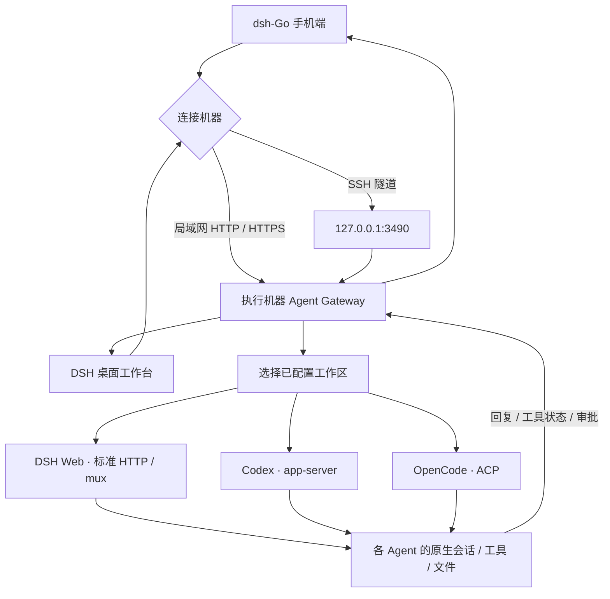

# Agent 工作台

桌面 DSH 和 dsh-Go 现在可以连接同一个独立网关，在机器、Agent、工作区、会话之间选择。网关部署在执行机器上；DSH 使用标准 Web 接口，Codex 使用 App Server，OpenCode 使用 ACP。会话、模型账号、工具和文件操作由对应 Agent 管理。



## 在执行机器启动

要求 Node.js 20 或更高版本，以及要使用的 Agent CLI。先在执行机器完成对应 Agent 的登录与模型配置。

```sh
npm ci
npm run gateway:init
```

初始化生成 `~/.dsh-agent-gateway/config.json` 和 `gateway.token`，默认绑定 `127.0.0.1:3490`。令牌不会输出到日志；在机器本地查看令牌并填入客户端。目录和文件应仅允许运行网关的用户访问，Windows 上检查该目录的 ACL。

编辑配置中的 `workspaces`，只列出允许客户端访问的项目目录。`agents` 可按实际安装情况禁用、改名，或指定 CLI 的绝对路径：

```json
{
  "id": "dev-machine",
  "name": "开发电脑",
  "host": "127.0.0.1",
  "port": 3490,
  "tokenFile": "gateway.token",
  "stateFile": "sessions.json",
  "workspaces": [{ "id": "project", "name": "项目", "path": "/srv/project" }],
  "agents": {
    "codex": { "kind": "codex", "command": "codex" },
    "opencode": { "kind": "opencode", "command": "opencode" },
    "dsh": {
      "kind": "dsh",
      "url": "http://127.0.0.1:3080",
      "tokenEnv": "DSH_WEB_TOKEN"
    }
  }
}
```

Windows 路径需要 JSON 转义，例如 `C:\\work\\project`。相对工作区路径相对于配置文件。`command` / `args` / `env` 仅由执行机器配置，客户端不能指定启动命令。`args` 会替换默认的 `app-server` 或 `acp` 参数，必要时填写完整参数数组。

```sh
npm run gateway:serve
# 自定义配置：
npm run gateway:serve -- --config /private/config.json
```

DSH 需要事先运行 `dsh web`，在网关进程的环境变量 `DSH_WEB_TOKEN` 中设置其启动令牌，或用 `tokenFile` 指向本机私有令牌文件。网关把启动令牌兑换成 DSH cookie；不会将其发送给手机或桌面。这里的 DSH 令牌和客户端填写的 **gateway.token 是两个不同的令牌**。DSH Web 重启并更换令牌后更新该文件，再重新连接。

执行端的 DSH 无需安装本插件。要控制 Codex/OpenCode 也无需启动 DSH。

## 桌面端

安装本项目后重启入口 DSH，打开侧边栏的 **Agent 工作台**。

1. 添加机器，填写名称和网关令牌。
2. 直连填写如 `http://192.168.1.10:3490`；SSH 填写系统 SSH 别名或 `user@host`、SSH 端口、远端网关端口。
3. 连接后选择 Agent、工作区和会话，或新建会话。

桌面 SSH 使用系统 OpenSSH 与现有 SSH config/key/agent。先在系统终端连接一次，确认主机指纹并配置免交互认证；工作台开启 `BatchMode` 和严格主机指纹检查，不保存 SSH 密码。隧道只把本机随机回环端口转发到远端 `127.0.0.1:3490`。客户端请求通过入口 DSH 的认证接口代理，浏览器不会直接获得已保存的网关令牌。

## 手机端

配套源码位于相邻的 `dsh-Go` 仓库。需要构建包含本次修改的 App；现有公开 APK 不包含本功能。

打开 **远程主机 → Agent 工作台**：

- 直连选择 HTTP(S)，输入网关地址和网关令牌。成功连接过的地址可通过地址输入框选择。
- SSH 先在原有远程主机页面保存 SSH 主机，再在工作台选择它，输入网关端口与令牌。复用原有密码/密钥存储，首次连接要求确认指纹，指纹变更拒绝连接。连接网关时不会自动启动远端 DSH。
- 网关令牌保存在系统安全存储，普通偏好设置只保存地址和主机标识。

SSH 方式保持网关默认回环监听即可。局域网直接 HTTP 访问时，将网关 `host` 改为该机器的局域网地址或 `0.0.0.0`，并允许局域网访问该端口。非可信网络使用 SSH 或配置 HTTPS 反向代理；服务本身不终止 TLS。

## 协议和边界

`POST /v1/call`，`Authorization: Bearer <gateway-token>`，JSON 请求 `{ "method": "node.describe", "params": {} }`。成功响应 `{ "ok": true, "result": ... }`；失败 `{ "ok": false, "error": { "code": "...", "message": "..." } }`。`GET /health` 不含机器与会话信息。

| 方法 | 主要参数 |
|---|---|
| `node.describe` / `agents.list` / `workspaces.list` | 无 |
| `sessions.list` / `sessions.create` | `agentId`, `workspaceId` |
| `sessions.read` / `sessions.cancel` | `sessionId` |
| `sessions.watch` | `sessionId`, `epoch`, `after` |
| `sessions.prompt` | `sessionId`, `text` |
| `sessions.approve` | `sessionId`, `approvalId`, `decision: allow / reject` |

`sessions.watch` 最长等待 20 秒，返回带 `epoch` 和递增 `cursor` 的完整投影。进程重启或游标不匹配时立即返回当前快照。服务只保存原生会话 ID 与工作区映射，不复制对话数据库。可见历史有容量上限，`hasMore` 表示只显示近期记录。

当前支持文本、思考、工具文本输出、一次性批准/拒绝、停止任务。文件浏览、终端、附件、模型切换和各 Agent 专有设置尚未提供统一 UI。审批仅处理相应 Agent 支持的一次性决策，不自动授予永久权限。

认证令牌代表对该执行机器所配置 Agent 和工作区的控制权限，当前没有按用户区分的 ACL。工作区选择限定项目入口，不替代 Agent 自身的沙箱和工具权限。多用户部署应隔离网关和运行用户。

发送消息、取消、审批不会自动重试。连接中断后通过重新连接并打开会话恢复历史；响应丢失时操作结果可能未知，需要检查 Agent 状态，必要时停止任务或重启网关，避免重复执行。网关进程关闭会关闭其管理的 Agent 子进程。服务托管可使用自己的 systemd/Windows 服务配置。

现有完整 DSH 界面切换及 relay 仍可继续使用；新增工作台的 HTTP/SSH 连接不依赖 relay。跨网中继、自动隧道恢复和统一文件/终端界面不在本次实现内。

## 来源与验证

- 本项目延用现有 DSH 历史事件转换和入口认证。
- dsh-Go 以 fork 提交 `62241f40e15a256c17e066c3900226c585df82bc` 为基线，复用其 SSH 传输、端口转发、安全存储和指纹确认界面。
- ds-harness-remote（`liguobao/ds-harness-remote`，参考提交 `b689d7f8f837f6adfbf9728b4ebb47c39d8834d6`，MIT）提供了采用 Codex 原生 App Server / OpenCode 原生 ACP、保留各自会话存储的设计参考。本次网关适配器按协议独立实现，没有复制其插件源文件。
- Codex 协议参考官方 `https://developers.openai.com/codex/app-server/`；DSH mux/ACP 结构同时对照 dsh-Go 客户端及参考项目。

```sh
npm run build
npm test
npm run gateway:probe
npm run gateway:probe-dsh
npm run test:workbench
```

`gateway:probe` 使用临时空 CLI 数据目录，只验证已安装 CLI 的握手和会话列表，不调用模型或读取用户会话。网关测试使用隔离进程和 DSH HTTP/mux 测试服务。真实手机、SSH 服务器及带模型执行的端到端操作仍需部署后验证。

2026-11-06 本地验证：插件构建与 63 项 Node 测试通过；桌面浏览器工作台交互通过；dsh-Go 静态分析、4 项纯 Dart 客户端测试及 67 项相关 Flutter 测试通过（包含工作台与 SSH 回归）。本机 Codex/OpenCode 在空数据目录完成真实协议握手与列表读取；未安装插件的独立 DSH Web 实例完成新建会话和 mux 跟随。`gateway:probe-dsh` 使用 Windows 上已安装的 DSH 桌面运行时建立隔离 Web 实例，不读取日常配置。
