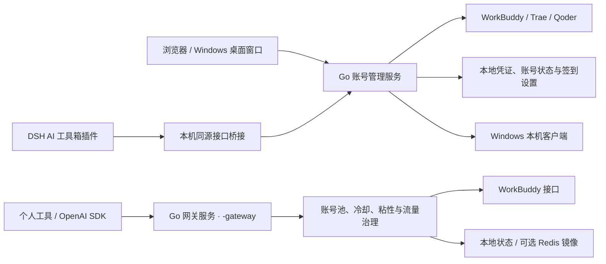

<p align="center">
  
</p>

<h1 align="center">WorkBuddy2API Panel</h1>

<p align="center">
  <b>WorkBuddy · Trae · Qoder 账号管理与每日签到 · 可选 OpenAI 兼容网关</b><br>
  AI 工具箱 · Windows 桌面窗口 · DSH 插件 · 账号切换 · 成长任务 · 活动奖励 · 状态持久化
</p>

<p align="center">
  
  
  
  
</p>

---

> 本目录是 [remote-session-plugin](https://github.com/gaolin89898/remote-session-plugin) 的 `toolbox/` 子项目（原 workbuddy2api-panel 仓库），命令默认在 `toolbox/` 下执行；DSH 插件已并入仓库根目录的 `dsh-remote-session`。

## 使用声明（必读）

本项目用于管理本人授权的 WorkBuddy / CodeBuddy、Trae 和 Qoder 账号，以及在本机或私有环境接入个人工具。请遵守各平台服务条款，不得用于批量注册、共享或转售账号额度、卡密分发及其他违规用途。

代码采用 MIT 协议，允许的使用和再分发范围以 [LICENSE](LICENSE) 为准；该许可不授予任何平台接口或服务的使用权，也不代表作者对第三方收费版本提供支持或背书。账号凭证、客户端登录快照和管理密钥应由本人保管。平台接口、活动规则和账号资格可能变化，执行结果以平台回读状态为准。

## 项目简介

WorkBuddy2API Panel 提供「AI 工具箱」账号管理页面，默认管理 **WorkBuddy / Trae / Qoder** 三个平台的账号、积分和每日签到，支持本机 Windows 客户端账号切换、WorkBuddy 成长任务与活动奖励。页面可通过浏览器、Windows 桌面窗口或 DSH 插件使用，账号和设置由 Go 后端持久保存。

直接运行程序进入账号管理模式；需要为个人工具提供 OpenAI 兼容接口时，使用同一程序加上 `-gateway`。

| 启动方式 | 页面与能力 | 自动运行 |
|---|---|---|
| 默认账号管理 | AI 工具箱：账号、任务中心、活动奖励、签到设置、运行日志；支持三个平台与本机客户端切换 | 按北京时间执行签到、按设置刷新积分和启动补签；任务与活动奖励手动执行 |
| `-gateway` | WorkBuddy 账号池管理、用量、模型、配置与日志，以及 `/v1/*` 接口 | 按 `config.json` 中的排程运行签到、保活、旅行、活跃等任务 |

默认模式不开放 `/v1/*`，不初始化网关用量统计、会话路由或 Redis。Trae / Qoder 账号管理和 DSH 插件连接默认账号服务；启用 WorkBuddy 网关不会为这两个平台增加 API 转发能力。

## 核心能力

| 能力 | 说明 |
|---|---|
| 多平台账号 | WorkBuddy 浏览器授权与 Cockpit JSON 导入；Trae 国内版直接登录、凭证及备份导入；Qoder 国内版浏览器授权或 PAT |
| 积分与每日签到 | 单号 / 全部签到、余额刷新、停用 / 启用、备注；每日 09:00 / 21:00 默认时刻可修改，Qoder 按 10:00 活动轮次处理 |
| 本机客户端切换 | Windows WorkBuddy / WorkBuddy AI、Trae CN、Qoder CN；登录态备份、重启后身份核验和失败回滚，支持自定义安装目录和 Qoder 更新目录 |
| 成长任务与活动奖励 | WorkBuddy 国内版个人账号扫描待办、执行全部待办、查看队列、领取奖励；企业身份按实际账号属性判断，执行后回读进度 |
| 状态持久化 | 凭证、账号状态、备注和签到设置保存在本地；网关模式额外支持用量归档及可选 Upstash Redis 镜像 |
| 页面与 DSH 插件 | Vue / Arco Design 页面，适配深浅色和移动布局；DSH「AI 工具箱」使用原生下拉菜单，主题与 Arco 滚动条跟随宿主 |
| OpenAI 兼容网关 | `-gateway` 下提供聊天补全、模型列表及 Anthropic Messages 兼容联网搜索；流式 / 非流式、推理内容、工具调用和模型档位兼容 |
| 网关账号调度 | 快过期积分加权、成本分层、轮询 / 顺序耗尽、冷却 / 熔断、在途租约和会话粘性；国内版与国际版可独立配置 |
| 网关运维 | 模型与积分包查询、用量和请求日志、配置热更新、独立任务排程、提示词处理及请求指纹脱敏 |

## 成长任务与活动奖励

WorkBuddy 国内版个人账号可在「任务中心」扫描待办、执行单项或全部待办、接受任务及领取奖励。执行会先确认，部分动作会发起真实模型请求并消耗积分；后端等待异步计分并回读任务进度，达标后领取奖励。任务清单、奖励和账号资格以平台当前返回结果为准，Trae / Qoder 暂未接入成长任务。

### 任务覆盖与奖励

| 任务 | 奖励 | 一键完成方式 |
|---|---|---|
| `first_buddy` | +300c +8e | 解锁上报 → 同意协议 → 领养第一只 Buddy |
| `create_canvas` | +300c +5e | 设计画布创建事件组（Ardot 遥测） |
| `chat_5` | +100c | 对话活跃上报 ×5（自动补足差额） |
| `Model_chat_GLM5.2` | +100c +5e | glm-5.2 真实对话一次（发一条短消息） |
| `RichMeow_Chat` | +100c +5e +UR Buddy | 桌面端对话事件链（6 事件，含成功回执） |
| `Buddy_App` | +100c +5e | Buddy 应用「发现→进入→授权」事件链 |
| `Buddy_App_QQ` | +50c +5e | 企鹅教师助手进入事件链（与上一条共用） |
| `automation_1` | +100c +5e | 定时任务创建成功事件 |
| `Library_read` | +100c +5e | 资料库阅读点击（web 域上报） |
| `template_5` | +100c +5e | 模板使用事件组 ×5 |
| `playbook_prompt` | +100c +5e | 灵感案例「做同款」发送事件 |
| `expert_5` | +100c +5e | 真实专家召唤+使用链 ×5（专家市场拉真实专家 → 真实对话 → 使用事件） |
| `Expert_team_use_3` | +100c +5e | 专家团召唤+使用链 ×3 |
| `Hp_Appearance` | +100c +5e | 主题设置 + 皮肤生效事件 |
| `Expert_lighthouse` | +100c +5e | 轻量云专家召唤+使用链（真实对话 requestId，**可免费领一个月轻量服务器**） |
| `skill_1` | +100c +5e | 真实对话 + 技能加载事件（skill_info） |

表中为已接入的任务动作及活动奖励示例，不保证每个账号都能领取。`Model_chat_GLM5.2`、专家与技能类任务可能涉及真实对话；重复执行仍需以任务当前进度和平台限制为准。

### 需要本人完成的任务

| 任务 | 原因 |
|---|---|
| `Expert_Philanthropy` | 需真实捐款（服务端领奖时校验捐赠回执，已实测无法绕过） |

### 实现原理（简述）

任务计分走 `/v2/report` 行为上报，但**不同任务认不同客户端指纹**：CLI 指纹（`www.codebuddy.cn`）、桌面指纹（`copilot.tencent.com` + `WorkBuddy/5.5.6` UA + `workbuddy-desktop` 事件族）、web 指纹（`www.workbuddy.cn` + `x-client-platform: web`）。网关为每类任务构造对应指纹的判据事件链（`internal/upstream/desktop.go`）；专家类任务额外要求真实专家 id 与真实对话回执（`internal/upstream/streak.go` 之外的 expert 序列）。上报 200 ≠ 计分——面板在执行后轮询任务进度，达标即自动调用 Web 域领奖接口。

已达标的任务会跳过，同一账号的任务操作串行执行；平台返回成功仍需任务进度回读确认，不能仅凭上报响应视为已完成。

### 任务中心

- **扫描全部待办**：查询 WorkBuddy 国内版个人账号的可执行任务，停用账号和不支持的身份会跳过或显示原因。
- **执行队列**：账号内串行，账号间可选 1–4 个并行；显示每项状态、完成进度和失败原因，支持单项执行及执行全部待办。
- **任务筛选**：按待执行、待领取、已完成和失败筛选，已达标任务可单独领奖。
- **运行日志**：查看任务执行结果；队列正在运行时避免重复提交。

<details>
<summary><b>开学季活动接口（已结束）</b>——活动期至 2026-09-24，点击查看接口与任务说明</summary>

以下记录已结束的「AI 好 Buddy，开学有好礼」活动接口，供协议和任务实现参考；账号管理模式不会把它挂在自动签到排程末尾：

| 任务 | 奖励（每日） | 判据（已逆向） |
|---|---|---|
| 分享活动 | +100c +1抽奖 | `share-complete` 直调即点亮 |
| 桌面端体验（单次） | +100c +1抽奖 | viewed 激活 + 真实 chat + 桌面六事件链 |
| 和 AI 对话 3 次 | +50c +1抽奖 | viewed 后 3 条 `chat_request_send` 埋点（无需真实会话） |
| 召唤开学季专家 | +50c +1抽奖 | viewed 后 mp 事件链（召唤×3 + 对话） |
| 学生认证 | +100c | 需微信学生真实认证，不做 |

抽奖次数自动全部抽完。相关实现保留在任务与上游接口代码中，活动是否可用以平台返回为准。

同一活动在成长任务中心还有两条**小程序口径**任务（`X-Client-Platform: miniprogram` 专属下发，默认列表不可见，各 +100c+5e）：

| 任务 | 判据（已逆向） |
|---|---|
| `school_season` 校园日 | mini `chat_request_send` + `activityId=school_open_day_2026`（无 activityId 不点亮；accept/claim 均要求 mp 头） |
| `Sequential_Tasks_1` 小程序首对话 | mini `chat_request_send`（无 activityId，服务端按 source=mini_program 指纹关联） |

任务中心扫描自动合并 mp 口径待办；accept 带**登记回读验证**（上游存在 200+OK 但未落账的形态，未生效自动重试一次）。

</details>

### 活动奖励

默认账号管理模式在「活动奖励」展示 WorkBuddy 官方补偿、连登兑换、抽奖机会及券码。进入页面只查询状态，领取、兑换和抽奖需手动操作；Qoder 每日奖励使用当前有效活动接口，领取后回读确认。Trae 暂未接入额外活动奖励。

网关模式可在签到排程末尾执行连登兑换与抽奖，见[定时任务](#定时任务)。该行为不适用于默认账号管理模式。

## 架构总览



DSH 提供页面和接口桥接，后台任务由目标电脑上的 Go 账号服务执行；远程会话通过 DSH 已注册接口转发，目标后端仍使用回环地址。网关模式的聊天请求在出站前经过 `internal/upstream/payload.go` 处理，包括流式归一、角色与工具参数兼容、思维链配置、推理内容回填和指纹脱敏。

## 快速开始

### 环境要求

- Go ≥ 1.22.5（从源码构建后端时需要）；已有二进制可直接运行。
- 修改前端时需要 Node.js 20.19+（20.x）或 22.12+；未修改前端时可使用仓库中已构建的 Go 内嵌资源。
- Windows 桌面窗口依赖 Microsoft Edge WebView2 Runtime；Trae 直接登录需要本机 Edge / Chrome 和桌面环境。
- Docker / Docker Compose 为可选部署方式。DSH 插件在当前选中的电脑访问当地后端；Windows 客户端切换操作对应电脑上的客户端。

### Windows 单文件运行

```powershell
# 从源码构建；也可使用可信构建产物
go build -trimpath -ldflags="-s -w" -o wb2api.exe ./cmd/server

# 本机使用时只监听回环地址
$env:WB2A_LISTEN='127.0.0.1:7863'
.\wb2api.exe -config config.json
```

打开 <http://127.0.0.1:7863/panel/>。首次启动缺少配置时自动生成 `config.json`，管理密钥位于 `api_key` 字段。账号、凭证和设置保存在本地，关闭浏览器不会停止独立运行的后端。

### Windows 桌面窗口

Windows 桌面版使用 `AccountsDesktop.exe`：双击直接打开 Vue / Arco Design 账号窗口，无需手动打开浏览器或输入本机管理密钥。前端和账号服务包含在同一个 EXE 中，使用系统 Microsoft Edge WebView2 Runtime；缺少运行时或启动失败会弹出错误提示，日志保存在账号数据目录的 `data/desktop.log`。优先使用 EXE 旁已有账号的配置；空目录启动时恢复记住的账号目录，位于 `data/releases/` 的构建也可识别原安装目录。数据目录位置保存在 `%APPDATA%/WorkBuddyAccounts/desktop-settings.json`，该文件只存配置路径，不存凭证。指定 `-config` 时严格使用该配置文件目录，不更改默认位置。首次使用且找不到已有账号时才在 EXE 旁创建空配置；打包不包含个人凭证。

桌面版只监听本机回环地址。相同配置的账号服务已运行时自动连接，其他程序占用端口时使用空闲本机端口。关闭窗口会停止由该窗口启动的签到服务，独立运行的原有后台服务继续运行。浏览器授权链接通过系统浏览器打开。

```powershell
cd web
npm ci
npm run build
cd ..
go build -tags desktop -trimpath -ldflags "-s -w -H=windowsgui" -o AccountsDesktop.exe ./cmd/server
```

### 源码运行与前端构建

```bash
# 修改页面后重新生成 Go 内嵌资源
npm --prefix web ci
npm --prefix web run build

# 启动默认账号服务
go run ./cmd/server -config config.json
```

修改内嵌页面后需要重新编译并重启 Go。仅更新独立 DSH 页面时，在插件目录构建和安装即可，无需重启 Go。

```bash
go build ./...
go vet ./...
go test ./...
```

### DSH 插件

DSH 插件已并入 `dsh-remote-session`（本仓库根目录），不再单独打包安装。升级时卸载旧的 `dsh-workbuddy-accounts` 插件，安装/更新合并后的插件即可；侧栏「AI 工具箱」入口、菜单与远程跟随行为不变。构建与验证见仓库根目录 [docs/ai-toolbox.md](../docs/ai-toolbox.md)。

独立 DSH Web 使用 `--profile web`。点击侧栏「AI 工具箱」展开五项菜单，嵌入页面使用整块内容区，主题与 Arco 滚动条跟随 DSH；管理密钥入口位于「签到设置」。Go 后端需在目标电脑单独运行。使用同一版本插件时，页面、账号统计、设置与客户端操作跟随当前电脑；目标电脑也需安装合并后的插件并运行账号服务。各电脑密钥和备注独立保存，连接失败会报错，不回退显示本机数据。已在 DSH `0.2.2-rc.1` 上验证宽屏与窄屏抽屉布局下的菜单、主题和接口连接。

### Docker Compose

```bash
git clone https://github.com/gaolin89898/remote-session-plugin.git
cd remote-session-plugin/toolbox
cp config.example.json config.json
# 编辑配置中的管理密钥，然后启动
docker compose up -d --build
curl -s http://localhost:7863/healthz
# 默认模式：{"service":"workbuddy-accounts","ok":true}
```

Compose 默认启动账号管理模式，数据通过 `auths/`、`data/` 和 `config.json` 挂载持久化。服务器上可使用普通浏览器面板；本机客户端切换和 DSH 接口桥接不提供远程桌面控制。

```bash
docker compose logs -f
docker compose restart
docker compose down
```

镜像构建与发布配置见 [.github/workflows/wb2api-docker.yml](../.github/workflows/wb2api-docker.yml)，使用预构建镜像时以当前仓库发布的镜像名和标签为准。

### 添加账号（登录）

在「账号」页选择 WorkBuddy、Trae 或 Qoder，再点击「添加账号」。各平台的登录方式、客户端切换及限制见[账号平台与客户端切换](#账号平台与客户端切换)。浏览器授权完成后自动保存凭证，具体签到行为以页面结果为准。

WorkBuddy 也可使用 Linux / macOS 的 `./login.sh`（依赖 bash 和 python3）完成设备授权、凭证保存和容器重启；Windows 用户可直接使用面板。

### 启用 API 网关

需要 WorkBuddy OpenAI 兼容接口时显式传入 `-gateway`：

```bash
go run ./cmd/server -config config.json -gateway
# 已构建的程序同样接受该参数
./wb2api -config config.json -gateway
```

Docker 镜像在入口参数末尾加 `-gateway`；Compose 可在 `services.wb2api` 下设置 `command: ["-gateway"]`。启用后 `/panel/` 显示网关管理界面，以下模型、状态、聊天和搜索验证仅适用于该模式。

```bash
# 模型列表
curl -s http://localhost:7863/v1/models -H "Authorization: Bearer your-api-key"

# 账号状态（汇总 + 每账号详情，disabled 账号透出 disabled_reason）
curl -s http://localhost:7863/status -H "Authorization: Bearer your-api-key"

# 流式聊天
curl -sN http://localhost:7863/v1/chat/completions \
  -H "Authorization: Bearer your-api-key" \
  -H "Content-Type: application/json" \
  -d '{"model":"deepseek-v4-flash","messages":[{"role":"user","content":"hi"}],"stream":true}'

# 非流式聊天（本地聚合）
curl -s http://localhost:7863/v1/chat/completions \
  -H "Authorization: Bearer your-api-key" \
  -H "Content-Type: application/json" \
  -d '{"model":"deepseek-v4-flash","messages":[{"role":"user","content":"hi"}],"stream":false}'

# 联网搜索（Anthropic Messages 兼容形态，走上游 /agenttool/v1/search）
curl -s http://localhost:7863/v1/search/messages \
  -H "Authorization: Bearer your-api-key" \
  -H "Content-Type: application/json" \
  -d '{"model":"deepseek-v4-flash","tools":[{"type":"web_search_20250305","name":"web_search"}],
       "messages":[{"role":"user","content":"Perform a web search for the query: OpenAI 最新模型"}]}'
```

## 配置说明

**`config.example.json` 是配置项最完整的参考**：每个字段、默认值与结构都能在其中找到，示例值一律是 `test_key` 之类占位符，**不含任何真实密钥**。下表为字段含义速查。账号管理模式使用基础配置及独立签到设置；账号池路由、会话粘性、Redis、用量与请求归档等字段仅在网关模式使用。

### 账号管理设置

默认模式从 `config.json` 读取监听地址、密钥、凭证目录和 `state_file` 等基础项。「签到设置」单独保存到 `state_file` 同目录的 `account-settings.json`，保存后立即应用，优先于启动配置中的签到默认值。

| 设置 | 默认 | 作用 |
|---|---|---|
| `checkin_enabled` | `true` | 每日自动签到总开关 |
| `checkin_hours` | `[9, 21]` | 北京时间签到时刻，0–23 点 |
| `refresh_after_checkin` | `true` | 签到后刷新余额 |
| `catchup_on_start` | `true` | 程序启动时补签当天未签到账号 |

开关开启为蓝底“开”、圆点在右，关闭为灰底“关”、圆点在左；编辑后点击「保存设置」才生效，「取消」恢复已保存选项。

### 字段速查

| 字段 | 默认 | 说明 |
|---|---|---|
| `listen` | `:7863` | HTTP 监听地址 |
| `api_key` | 空（首次自动生成配置时写入随机值） | 面板及网关鉴权密钥；**空 = 不鉴权直接放行**（公网必须设置） |
| `auth_dir` | `./auths` | 账号凭证目录 |
| `state_file` | `./data/state.json` | 账号池状态持久化文件 |
| `dns_servers` | 空 | **出站解析**用的 DNS 服务器（数组，按顺序试，都用不上才报错）；空 = 系统解析器。/etc/resolv.conf 不存在或不可用的环境（Android、精简容器）必须显式配，否则 Go 解析器会退回 `127.0.0.1:53`，查任何域名都变成"连本机 53 端口"（`dial tcp: lookup ... on [::1]:53: connection refused`）。只换 `Transport.DialContext`，不动超时与连接池 |
| `server.read_timeout` | `300s` | 入站请求读取（含 body 上传）总时长上限；大上下文/文件块经反代转发超时会 400 `read body: i/o timeout`；`0` = 不限制；改动需重启（#100） |
| `panel.package_detail_limit` | `5` | 网关模式积分构成页单账号默认展示的最早到期包数；其余未用完包与已用完包聚合折叠 |
| `logging.request_archive_enabled` | `true` | 请求元数据 JSONL 归档开关；不记录提示词、响应正文或 Authorization |
| `logging.request_retention_days` | `7` | 请求归档保留天数；超期文件在启动和周期清理时删除 |
| `logging.request_archive_max_mb` | `100` | 请求归档总容量上限（MiB）；超限优先删除最旧文件 |
| `cooldown.soft_rate` | `600s` | 软限流（429 / 限流文案）冷却基数；同一账号连续触发按 2 倍指数退避 |
| `cooldown.soft_rate_max` | `2h` | 软冷却指数退避封顶 |
| `schedule.checkin_hours` | `[9, 21]` | 每日本地时区整点签到 + 余额查询解冻。空数组 / `null` = 未配置回落默认（不是禁用） |
| `schedule.travel_hours` | `[9, 21]` | 每日本地时区整点推进猫猫旅行状态机（领养 / 派出 / 领奖） |
| `schedule.activity_hours` | `[10]` | 每日本地时区整点对话活跃上报（点亮连登 + 解锁 `first_buddy`） |
| `schedule.keepalive_hours` | `[22]` | 每日本地时区整点刷新 token 保活 |
| `schedule.blackcat_hours` | `[23]` | 每日本地时区整点夜猫子补足（23:00–08:00 计数窗口） |
| `schedule.checkin_enabled` | `true` | 签到总开关；`false` 真正关闭 |
| `schedule.travel_enabled` | `true` | 猫猫旅行总开关（独立于签到） |
| `schedule.activity_enabled` | `true` | 活跃上报总开关 |
| `schedule.keepalive_enabled` | `true` | token 保活总开关 |
| `schedule.blackcat_enabled` | `true` | 夜猫子总开关 |
| `schedule.include_disabled_in_tasks` | `false` | 让**保号类**四任务（签到 / 活跃上报 / token 保活 / 余额刷新）对**已禁用**账号也执行——「禁用」只关选号，不停保号。`false`（默认）保持「禁用的跳过」 |
| `upstream.timeout_seconds` | `120` | 短 RPC（刷新 / 签到 / 余额 / 模型列表）总时长上限 |
| `upstream.header_timeout_seconds` | 回落 `timeout_seconds` | 聊天首字节前（响应头）上限 |
| `upstream.idle_timeout_seconds` | `300` | 聊天流中空闲上限（活跃续命，静默断流） |
| `upstream.user_agent` | 空 | 聊天、模型查询及凭证刷新请求的 User-Agent 覆盖；留空时使用按账号地区生成的 WorkBuddy 三段式 UA |
| `upstream.client_version` | 空（内置 `5.5.4`） | WorkBuddy 客户端版本，用于默认 UA 及客户端归属头 |
| `upstream.cli_version` | 空（内置 `2.137.1`） | 默认 UA 中的 CLI 版本段 |
| `features.sanitize_blacklist_fingerprints` | `true` | 出站请求体黑名单指纹脱敏 |
| `models.hidden` | `[]` | 模型黑名单：不对外暴露的模型。裸名=两域都藏；`"cn:xxx"`/`"global:xxx"`=只藏该域。`GET /v1/models` 列表过滤 + `POST /v1/chat/completions` 点名拒绝（400 `model_unavailable`）。面板保存后热生效 |
| `prompt.mode` | `custom` | 系统提示词模式：`custom` = 网关用自有提示词替换客户端 system；`append` = 开头连续 system/developer 块后插网关提示词（既有消息逐字不动）；`passthrough` = 透传客户端原始 system（降级重试仍切中性提示词） |
| `prompt.file` | 空 | 提示词文件路径；空 = 内置默认（约 2KB）；路径非空但不可读 → 启动报错 |
| `upstash.url` / `upstash.token` | 空 | 网关模式可选 Redis 镜像；未配置时仍有本地状态文件，默认账号管理模式不初始化 Redis |
| `pool.max_in_flight` | `3` | 单账号最大在途请求数（`0` = 不限） |
| `pool.max_in_flight_global` | `2` | global 域单账号在途上限（国际版 WAF 风控更紧，压低并发） |
| `pool.degrade_threshold` | `5` | 连败降权阈值：未知错误（ErrClient/传输层）连败 N 次临时出池 |
| `pool.degrade_cooldown` / `pool.degrade_cooldown_max` | `10m` / `2h` | 连败降权时长与上限钳制 |
| `pool.cost_explore_interval` | `30m` | costTier 条件探索窗口：免费层垄断且存在未知号时，每窗口把一个真实请求搭车改道给未知号（零新增上游请求；成功即毕业，失败走既有错误策略）。`0` = 关停 |
| `pool.credit_floor` | `100` | **积分保底**：账号余额低于该值时，对**实测收费**模型（tier 2，账本 6h 内有效观测）不再参与选号——防止收费模型把余额打穿、连免费模型都 402 冷却到次日签到（最坏约 11.5 小时不可用）。tier 0（实测免费）/ tier 1（无观测）**不受限**：保底保的是「留余额给免费模型用」，且 tier 1 若拦会让账本过期 / 重启清零的触底号死锁在「学不回来」。含会话粘性路径（粘性号触底则解绑换号）。全池触底且全 tier 2 时选号返回空（网关回 503），**不放行**。签到回血越过 floor 即刻自动恢复。`0` = 关闭 |
| `pool.cross_domain_fallback` | `false` | **裸模型名跨域回退**（issue #135）：开启后，请求 `model` 不带 `cn:` / `global:` 前缀时不再等价于 `cn:<模型>`——首选域（cn）选不到可用号（账号级冷却/熔断/在途占满，或该域账号对这个模型 11102 后被模型级负缓存避开）会自动改用另一域再选一次，客户端只写一个模型名即可跟随账号池切换。显式 `cn:` / `global:` 前缀**永不回退**（写哪个域就用哪个域）。跨域会消耗另一个域的额度，故默认关闭 |
| `pool.breaker_threshold` | `3` | 连续失败触发熔断阈值 |
| `pool.breaker_cooldown` | `30m` | 熔断基础退避时长 |
| `pool.breaker_cooldown_max` | `6h` | 熔断指数退避封顶 |
| `pool.idle_weight_per_hour` | `0.5` | 闲置补偿：每小时未使用 +0.5 权重 |
| `pool.idle_weight_max` | `5.0` | 闲置补偿权重封顶 |
| `pool.strategy.domestic` | `weighted_random` | 国内版账号池调度：`weighted_random` / `round_robin` / `sequential_exhaust`，支持热更新 |
| `pool.strategy.international` | `weighted_random` | 国际版账号池独立调度策略，同上；不改变既有地区路由 |
| `pool.account_order.domestic` / `international` | `[]` | 对应地区的 UID 优先顺序；未列出账号按 UID 排序追加；只用于轮询和顺序耗尽 |
| `pool.prefer_expiring` | `true` | 快过期积分加权：窗口内仍有有效快过期批次的账号，选号权重 ×3（虚拟实例）；不按到期时间排序、与批次金额无关；是软偏好，弱于会话粘性与模型成本分层（#101） |
| `pool.expiring_soon` | `168h` | 快过期加权窗口：仅窗口内仍有有效批次的账号命中上述 ×3；窗口开大 → 命中账号变多、偏好被稀释；留空或 `0` 关闭 |
| `session_sticky.enabled` | `true` | 会话粘性路由开关 |
| `session_sticky.ttl` | `30m` | 会话绑定 TTL（滚动续期） |
| `session_sticky.gc_interval` | `5m` | 过期绑定 GC 周期 |

### 上游超时语义（三段各归其位）

| 字段 | 作用对象 | 默认 | 行为 |
|---|---|---|---|
| `timeout_seconds` | 短 RPC（token 刷新 / 签到 / 余额 / 模型列表） | `120` | 总时长硬上限，到期报错走换号 / 熔断 |
| `header_timeout_seconds` | 聊天 SSE **首字节前** | `120` | 由 `Transport.ResponseHeaderTimeout` 约束；超时 = 换号重发 |
| `idle_timeout_seconds` | 聊天 SSE **流中空闲** | `300` | 活跃吐数据续命不掐；静默超时才断流释放租约 |

聊天流（`stream` true / false 均同）**没有总时长上限**：聊天使用 `Timeout=0` 的专用 client，长思考 / 长输出不会被掐断。

### 环境变量覆盖

加载顺序：JSON 文件 → `WB2A_*` 环境变量（变量非空才覆盖）：

`WB2A_LISTEN` · `WB2A_API_KEY` · `WB2A_AUTH_DIR` · `WB2A_STATE_FILE` · `WB2A_DNS`(逗号分隔多个) · `WB2A_SOFT_RATE`(duration) · `WB2A_SOFT_RATE_MAX`(duration) · `WB2A_TIMEOUT_SECONDS` · `WB2A_HEADER_TIMEOUT_SECONDS` · `WB2A_IDLE_TIMEOUT_SECONDS` · `WB2A_USER_AGENT` · `WB2A_SANITIZE_FINGERPRINTS`(bool) · `WB2A_PROMPT_MODE` · `WB2A_PROMPT_FILE`

## 核心行为语义

以下请求处理、账号池路由、会话粘性及高级排程说明适用于 `-gateway` 模式。默认账号管理的签到和启动补签使用上面的独立设置。

### 系统提示词体系

客户端（Claude Code / Codex 等 CLI）会在 system prompt 注入固定模板句，上游内容审核按**逐字精确匹配**误杀合法流量（HTTP 400 + 审核文案）。网关提供两层防护，互不替代：

1. **提示词体系**（解决 **system / developer 来源**的误报）：由 `prompt.mode` 控制
2. **指纹脱敏**（兜底 **用户 / assistant 消息**里的指纹串）：由 `features.sanitize_blacklist_fingerprints` 控制

| 模式 | 语义 |
|---|---|
| `custom`（默认） | 出站前用网关自有提示词**替换**客户端 system / developer 消息（删除全部 system / developer，头部插入单条 system）；user / assistant / tool 消息逐字不动 |
| `append` | 开头连续 system / developer 块之后**插入**一条网关自有 system，既有消息（含客户端项目规范/工具约定）逐字不动——两者并用；降级期退化为 replace（带指纹原文重试只会确定性再撞 400） |
| `passthrough` | 透传客户端原始 system，不做改写 |

内置默认提示词约 2KB（`internal/prompt/defaultprompt.md`，嵌入二进制）。`prompt.file` 指向自定义提示词文件（自定义人格 / 人设）即整体替换内置默认；**留空 = 内置默认**，路径非空但不可读 → **启动报错**（fail fast，不会静默回落到内置默认）。

### 内容拦截误报与降级重试

`passthrough` 模式请求被上游内容策略拦截（HTTP 400 + `blocked by security policy` / `unapproved channel` / `illegal api invocation` 文案）时，判定为 system 指纹误报：**同请求内**换 Degraded 中性提示词重试一次；第二次仍被拦（用户内容本身触发审核）→ 走既有错误路径返回客户端，并如实报给调用方。

- 触发降级后持续到**次日 00:00 CST**（Asia/Shanghai）重置；降级期内 `passthrough` 请求直达中性提示词，不再先撞 400
- 降级状态是**进程内存态**，重启清零
- 内容问题非账号问题：`ErrContentBlocked` 不罚账号（无冷却 / 熔断 / 计错），由网关降级重试消化

### 原生工具调用标记还原

上游（DeepSeek 系）的工具调用原生语法不是 OpenAI 的 JSON `tool_calls`，而是一段带**全角竖线**（U+FF5C）分隔符的标记文本：

```text
<PIPE>DSML<PIPE> calls>
<PIPE>DSML<PIPE> invoke name="exec_command">
<PIPE>DSML<PIPE> parameter name="cmd" string="true">ls -la<PIPE>DSML<PIPE> parameter>
</PIPE>DSML<PIPE> invoke>
</PIPE>DSML<PIPE> calls>
```

（上面用 `<PIPE>` 占位，真实分隔符是两个全角竖线。）

上游**只在请求声明了 `tools` 时**才把这段标记解析成结构化 `tool_calls`。一旦某次请求没带上 `tools`——实测这在链路上是常态（协议转换丢字段、一次性 `exec` 探测、auto-review 复核回合等）——模型仍然想调工具，于是标记以纯文本落进 `content`。下游没有任何一层认识它：Codex 只执行 Responses API 的结构化 `function_call` 条目，于是把它当普通助手正文写进会话历史，回合直接 `task_complete`、工具一次都没跑。

网关在出站响应里做最后一道还原（`internal/upstream/dsml.go`），判定分两级：

| 工具名单状态 | 判定 |
|---|---|
| 非空 | **严格**：块内每个工具名都必须在名单里 |
| 为空（`tools` 丢失，实测常态） | **弱**：块必须完美闭合，且工具名形如合法标识符（`^[A-Za-z0-9_][A-Za-z0-9_.:-]{0,63}$`） |

名单有两个来源，二者会分别缺失，所以都要：**本请求声明的工具**（`tools[].function.name` / `tools[].name` / `functions[].name`）与**会话历史里出现过的工具名**（`messages[].tool_calls[].function.name`）。

还原还受三条硬性前提约束：本回合上游没有给出任何结构化 `tool_calls`（不覆盖真实调用）、块内除 invoke/parameter 与空白外不夹带正文、非流式额外要求 `finish_reason` 为 `stop`。**任何一条不满足即原文逐字节透出**——未闭合、参数畸形、超长（>256KB）一律回吐，修复层绝不吞字节。

命中与否各记一行日志，便于排障时区分「没识别到」与「识别到但判定不通过」：

```text
INFO: [server] stream ...: repaired N native tool call(s) from assistant text (tool names known=K)
WARN: [server] stream ...: saw M native tool call block(s) but repaired none (tool names known=K)
```

### 错误分类与账号处置

上游错误由 `Classify` 统一分类（判定优先级：余额耗尽 → session 失效 → 限流文案 → 状态码兜底），账号处置如下：

| 分类 | 触发条件 | 账号处置 | 恢复 |
|---|---|---|---|
| 余额不足 | HTTP 402 / body 含余额关键词 | 硬冷却到**次日 04:00**（本地时区） | 签到（09/21 点）余额恢复自动解冻 |
| 频控 | HTTP 429 / 限流文案（不限状态码） | 软冷却 `soft_rate`（600s 起，连续触发指数退避，封顶 `soft_rate_max`）。**`code 6004`（模型级）带「将在 … 重置」时**冷却到上游重置墙钟并豁免切模型（见[常见问题](#429-code6004模型级限流的冷却语义)） | 到期自动恢复 / 成功清零退避 |
| Session 失效 | body 含 `Offline user session not found` / `12153` | **连续 3 次**才永久禁用（一次 12153 多为临时抖动：网络 / 闪断 / refresh 竞态）；刷新成功 / 任意成功 / 手工复活清计数 | 人工重新登录（`login.sh`）或 `ReviveDisabled` 复活 |
| 上游 404 | HTTP 404 | 软冷却固定 60s（不随 `soft_rate`、不单独退避） | 到期自动恢复 |
| 服务端错误 | HTTP ≥500 | 喂连续失败计数，达阈值熔断 | 熔断到期 / 成功清零 |
| 请求体解析失败 | HTTP 400 + `Unmarshal chat params failed` / code `11101` | **不罚账号，但仍轮转**（客户端畸形 JSON，换号照样 400） | 即时 |
| 内容拦截 | HTTP 400 + 审核文案 | **不罚账号**，`passthrough` 模式走降级重试 | 即时 |
| 客户端错误 | 其余 4xx / 业务 `code≠0` | 不处罚，换号重试 | 即时 |

请求体解析失败（`11101`）与内容拦截一样**不罚账号**：问题在请求内容而非账号健康。网关不做请求体截断与预拦截，`11101` 均为客户端发来的畸形 JSON。

**熔断器**：所有冷却入口与 5xx 共用唯一连续失败计数器 `fails`；累计达 `breaker_threshold`（默认 3）触发熔断，退避 `breaker_cooldown × 2^retryCount`，封顶 `6h`；成功清零。

**软冷却指数退避**（与熔断器并存的第二条升级线）：软限流的**冷却时长**本身也按连续次数退避——同一账号连续触发软冷却时 `soft_rate × 2^(连续次数-1)`，封顶 `soft_rate_max`。计数 `soft_streak` 独立于熔断器的 `fails`，只在**成功**或**签到解冻**时清零，随 `state.json` 持久化。

### 选号策略

1. 过滤：禁用 / 冷却 / 熔断 / 在途占满账号不参与
2. 按模型实测成本分层，只保留当前最优层
3. 默认开启快过期积分加权（软偏好，不改排序）：

   - 在模型成本最优层内，`expiring_soon` 窗口内仍有有效快过期批次的账号，选号权重 ×3（`expiringVirtualSlots` 虚拟实例展开，会话粘性路径同口径）。
   - 不按到期时间排序、与批次金额无关：14 天后到期与 3 天后到期、1 分与几千分，只要在窗口内待遇相同。
   - 该偏好弱于会话粘性（绑定号健康则直接使用）与模型成本分层（按实测成本硬过滤）；已过期、零余额、无有效到期时间的账号不进入加权集。
4. 同一候选池内加权随机（快过期命中账号在上面的基础上 ×3）：

   `weight = credits 比例 ×10 + idleWeight`

   - `credits 比例` = 该号积分 / 候选集最大积分
   - `idleWeight` = `min(闲置小时 × idle_weight_per_hour, idle_weight_max)`，从未使用给满分
5. 防惊群：跳过 100ms 内刚被选中的账号；全冷却时从非禁用、非余额耗尽的软冷却 / 熔断账号中选最早到期者顶班

### 按地区配置账号池调度

国内版（`cn`）与国际版（`global`）可独立选择策略，例如：

```json
{
  "pool": {
    "strategy": {
      "domestic": "weighted_random",
      "international": "sequential_exhaust"
    },
    "account_order": {
      "international": ["uid1", "uid2", "uid3"]
    }
  }
}
```

- **加权随机**：保留原有成本分层、Top5 加权、闲置补偿和快过期积分权重。旧配置缺少策略时，两域均使用此默认值。
- **轮询**：在当前最优成本层的全部可用账号之间按顺序轮换，不截断 Top5。跳过禁用、暂停、对应模型冷却、积分保底拦截及在途占满的账号。
- **顺序耗尽**：持续使用当前账号，直到对应模型冷却、账号不可用、积分保底拦截或成本层优先级变化，再向后切换。恢复的早序账号不会抢占仍可用的当前账号，后续轮转可再次使用。请求级重试和在途占满可暂用其他账号，但不推进主账号；普通失败仍按现有熔断规则处理。

两种有序策略仍遵守会话粘性和成本探索，轮询指针 / 顺序耗尽主账号按 `(realm, model)` 独立维护，通过既有本地状态与 Redis 快照机制恢复。全部候选冷却时返回无可用账号，等待既有恢复机制，不提前试探冷却账号；加权随机继续保留原有全冷却兜底。选号和指针更新持池锁，在途租约仍由既有 Acquire/Release 保证。

Web 面板「账号池与流量治理」可分别配置策略和账号顺序，保存后热生效。闲置补偿与快过期积分加权仅影响加权随机。无地区上下文的旧 Pool 入口保留原行为；策略不会改变路由或自动跨地区借号。

本功能不假定国际版免费模型已采用五小时限额；限流及恢复时间继续依据现有上游识别逻辑处理，不硬编码五小时。

### 会话粘性

同一会话尽量复用同一账号，多轮对话不跳号：

- 会话键提取顺序：`metadata.conversation_id` → `metadata.conversationId` → `metadata.user_id` → 顶层 `conversation_id` → 顶层 `conversationId`（snake_case 优先于 camelCase）
- TTL 滚动续期（默认 30m），GC 周期 5m；绑定可镜像到 Redis（7 天 TTL）防重启丢失
- 请求失败自动解绑；成功后绑定跟随最终成功账号

### 定时任务

默认账号管理模式仅自动执行签到、按设置刷新积分和启动补签，时间固定为北京时间；成长任务、旅行、活跃上报和抽奖不会自动执行。

网关模式按 `config.json` 分别调度下列任务，容器时区由 `TZ` 控制（Compose 默认 `Asia/Shanghai`）：

| 任务 | 开关（默认 true） | 时刻（默认） | 行为 |
|---|---|---|---|
| 签到 | `schedule.checkin_enabled` | `checkin_hours` `[9, 21]` 整点 | 签到 + 余额查询；余额恢复则解冻冷却账号。**末尾追加连登管家**（见下） |
| 活跃上报 | `schedule.activity_enabled` | `activity_hours` `[10]` 整点 | 对话活跃上报（`chat_request_send` 事件，必须含 `userId`）；点亮连登 + 解锁 `first_buddy`；每号每天 1 次 |
| 猫猫旅行 | `schedule.travel_enabled` | `travel_hours` `[9, 21]` 整点 | 独立排程：无猫领养 / `idle` 派出 / `arrived` 领奖 |
| 保活 | `schedule.keepalive_enabled` | `keepalive_hours` `[22]` 整点 | 全账号刷新 token；session 失效**连续 3 次**才自动禁用 |
| 夜猫子 | `schedule.blackcat_enabled` | `blackcat_hours` `[23]` 整点 | **先查任务进度再决定**：`black_cat` 未达标才在 23:00–08:00 计数窗口内补足 glm-5.2 短对话（每天 1 次累计 3 天，漏跑次日窗口自动补） |

#### 禁用账号与保号任务（`schedule.include_disabled_in_tasks`）

缺省 `false`：禁用账号被上述**签到 / 活跃上报 / 保活 / 余额刷新**四任务跳过，与选号过滤一致。

面板「禁用」的语义是「**不再参与选号**」，但这四类任务此前会一并跳过禁用号——被禁用的账号因此拿不到签到积分、不续 token、余额也不再刷新；而 `ReenableIfCredits` 明确不复活 disabled 账号，等于签到这条唯一的自动回血路径也断了，只能人工点「解冻」。

如果采用「**一次只放开一个账号、用禁用做流量开关**」的轮换方式（同 IP 多号怕触发风控），闲置待命的号恰恰是最需要签到的——把它设为 `true`，禁用号仍会签到 / 保活 / 刷新余额，**但依旧不参与选号**（`pool` 选号侧的 disabled 过滤不受本开关影响）。

> 该开关**只覆盖调度器的这四类任务**。猫猫旅行、夜猫子、连登管家（挂在签到末尾的 `RunStreakBonusNow`）与成长任务队列**仍按原样跳过禁用账号**——若也需要，请另行提出。

#### 暂停选号（账号级 `paused`，无需配置）

比上面的全局开关更常用的账号级入口：面板账号行的「**暂停选号**」按钮。暂停的账号：

- **退出选号**（含全冷却兜底），状态显示「已暂停选号」，点「恢复选号」即刻回池——不清冷却域、无需解冻或重登；
- **无条件照常保号**：签到 / 活跃上报 / 保活 / 余额刷新四任务照跑（不依赖 `include_disabled_in_tasks`）；
- **其余任务体系照常**：猫猫旅行（纯 RPC：状态/派出/领奖）、连登管家、成长任务队列与任务中心扫描/执行都照常参与——这些走的是上报/领奖接口，不发模型对话（个别任务动作自带一次真实短对话，如 `Model_chat_GLM5.2`，影响可控）；失败照常记错误行，不特殊处理；
- **唯一跳过的是夜猫子**：`RunNightChats` 逐条发真实 glm-5.2 对话，是任务体系中唯一「整任务都是模型对话」的，与「让位防风控」正面冲突。

这正是「一次只放开一个号、其余让位」轮换用法想要的粒度：让位的号不再承接**选号流量**，也避开夜间的对话补足；其余养号动作照常。与「禁用」的区别：禁用是终态（session/授权判死，需人工解冻，保号默认也停），暂停是运维临时态（账号健康，随时恢复）。状态持久化（state.json `paused` 字段），跨重启不丢；`disable`/`revive` 会一并清掉 `paused`。

#### 企业版账号（自动识别，无需配置）

`auth` 文件带非空 `enterpriseId` 的账号被识别为**企业版**（面板账号名旁显示「企业版」标签）。`token_source=enterprise_switch` 仅表示凭证签发来源，不能据此把个人账号判为企业账号。企业版**没有个人成长体系**——上游对这些端点一律拒绝（实测 2026-10-07，同一时刻与个人号 A/B 对照）：

| 端点 | 企业版响应 |
|---|---|
| `POST /v2/billing/meter/daily-checkin`（签到） | `400 code 10001`「企业账号不支持该操作」 |
| `POST /billing/meter/claim-gift` / `claim-compensation`（夜猫子领奖） | `400 code 10001` 同上 |
| `POST /billing/meter/compensation-status`（补偿状态查询） | 网关**在门控处一并跳过**（与 claim-compensation 同属无补偿体系的调用） |
| `GET /activity/growth/*`（连登 / 旅行 / 热力图 / 抽奖）与 `GET /v2/activity/growth/tasks`（成长任务） | `403`「growth system is only available for personal users」 |

因此网关对企业号**不发起**这五类调用（签到 / 活跃上报 / 猫猫旅行 / 夜猫子 / 连登管家），面板也不渲染「签到」「任务」按钮（只留「额度」）。判定（`auth.Auth.IsEnterprise()`）与既有 `IsGlobal()`（D4 门控）在**同一批引用处并列书写**，`upstream` 侧零改动。

**企业版照常的能力**：选号派发、保活（token 刷新仍必需——不刷新同样会过期失效）、额度查询。

企业额度不在个人「资源包」体系内（`get-user-resource*` 对 `enterpriseId` 账号恒返回空 `Accounts`，面板因此长期显示 0），故额度改走 `POST /v2/billing/meter/get-enterprise-user-usage`：上游 `credit` 是**本周期已用**（与个人口径「剩余」语义相反），`limitNum` 是**分配给该账号的额度**，网关据此换算 `剩余 = limitNum - credit`；`limitNum = -1` 为不限量（面板显示「不限」，且不参与周期分桶）。企业配额按周期重置（`cycleResetTime`），未用完即作废，故周期末会参与 `prefer_expiring` 优先消耗。

> 成员账号**无权查询企业池总额度**（实测：池端点在成员 token 下返回 `403 not_authorized`，`/console/accounts` 显示 `isAdmin=false`）。面板展示的只是**该账号被分配的额度**；企业池余额只有企业管理员在管理后台可见。

#### 连登管家（签到排程末尾自动执行）

成长中心的连登档位（连续登录 7/14/28 天）兑换后发放积分 / 能量 / 补签卡 / **抽奖次数**，抽奖次数只能从兑换获得。管家在每日签到后自动跑一遍闭环（幂等，未解锁静默跳过）：

1. 查连登档位状态 → 已解锁（非 locked / 非 claimed）的档位自动**兑换**
2. 查抽奖次数 → **有次数自动全部抽完**，奖品记日志（`streak-bonus <uid>: 🎲 …`）

仅网关模式跟随签到排程；到天数那天自动完成「兑换 → 抽奖」，无需人工盯。

**关闭定时任务**：用 `schedule.*_enabled: false` 显式关闭（相应任务设为 `false` 后停止该排程）。注意两点语义：

- **空数组与 `null` 表示「未配置 → 回落默认」**，不是「禁用」；真正关闭请用 `*_enabled: false`
- **禁用不会擦除小时配置**：`*_hours` 原样保留，改回 `true` 即恢复原时点；小时值必须是 0-23，非法值启动即报错
- 关签到会把「余额恢复即解冻」一起关掉，被硬冷却的账号只能等次日 04:00 自然到期

#### 活跃上报（独立排程）

对池内每个可用账号在 `activity_hours`（默认 `[10]` 整点）发送一条对话活跃上报（事件 `chat_request_send`，body 为数组，事件必须含 `userId`）：

- 一条上报同时点亮 growth 连登 + 解锁 `first_buddy` 任务（领养前置）
- 每号每天 1 次即可（单时点）：日活跃奖励按天去重，重复上报无额外收益
- `conversationId` 由网关生成（`wb2api-<ms>`），无需真实会话
- 限速：账号间间隔 800ms（与旅行同口径）
- **streak 自检**：上报成功后回读连登天数（只读 oracle），日志每号一行可 grep：`activity <uid>: streak days=N`。`days=0` 记 **warn**（`report OK but streak.days=0 (silent drop?)`，对应上游「200 但静默丢弃」）；回读失败记 warn 但不影响主流程（上报按天幂等，不重试，只观测）
- 手动诊断 / 补跑用 `python3 scripts/probe_active.py`（只读探测；写操作默认 dry-run，需 `--yes`）

#### 猫猫旅行（独立排程）

对池内每个可用账号在 `travel_hours`（默认 `[9, 21]` 整点）单趟推进一次，每趟只做一个动作，不轮询不等待。默认两趟闭环：9 点领昨日到站奖励并派出，21 点领当日到站奖励（`daily_limit_reached` 自动挡住二次派出）。

| 探测结果 | 动作 |
|---|---|
| 无猫（`buddy` 为 `null`） | 先同意协议（幂等），再尝试领养；过门槛则 +300 积分并获得猫 |
| `state=idle` 且今日未派出 | 派出 `location_id=4`（古镇客栈；4 个地点收益 / 时长区间相同，无最优解） |
| `state=arrived` | 领取到站奖励（带 `record_id`） |
| `state=traveling` / 今日已达上限 / 未知状态 | 跳过 |

- 领养门槛未达标时上游返回 HTTP 400，每账号每自然日只尝试一次（跨日重试，记录仅存内存）；门槛可用活跃上报解除
- 限速：账号间间隔 800ms
- 每自然日 1 次派出：按 CST（Asia/Shanghai）自然日重置，与容器 `TZ` 无关
- 失败隔离：单账号失败只跳过该账号当趟；401 不强刷（token 刷新交保活时点）

## 网关搜索接口

以下接口需要使用 `-gateway` 启动。

### 联网搜索 `POST /v1/search/messages`

把上游 `/agenttool/v1/search` 包成 **Anthropic Messages 兼容**的搜索端点。这样任何按
`${baseURL}/messages` 发起搜索的客户端（如 DSH 的 `web-search-deepseek`）只需把搜索
baseURL 指向 `<网关>/v1/search`，即可零代码接入本网关的搜索能力。

与 chat 共享同一套账号池语义：选号轮转、在途租约、token 临近过期自动刷新、失败按错误
类型冷却或熔断。

**为什么不用 `/v1/messages`**：那是 Anthropic 模型对话的标准路径，留给未来的 chat 转发；
搜索挂在 `/v1/search/messages`，语义清晰且互不干扰。

请求（Anthropic Messages 形态）：

```json
{
  "model": "deepseek-v4-flash",
  "max_tokens": 4096,
  "tools": [{ "type": "web_search_20250305", "name": "web_search", "max_uses": 5 }],
  "messages": [
    { "role": "user", "content": [{ "type": "text", "text": "Perform a web search for the query: OpenAI 最新模型" }] }
  ]
}
```

- `tools` 必须声明 web_search（`type` 以 `web_search` 开头或 `name` 为 `web_search`），
  否则返回 400——本端点只服务搜索，不处理模型对话
- 搜索词取自 user 消息文本，固定前缀 `Perform a web search for the query:` 会被剥离
- 结果条数固定为官方默认值 5（服务端实际上限约 10）

响应为 Anthropic Messages 形态，搜索结果在 `web_search_tool_result` block 里：

```json
{
  "id": "msg_wb2api_...",
  "type": "message",
  "role": "assistant",
  "model": "deepseek-v4-flash",
  "content": [
    {
      "type": "web_search_tool_result",
      "tool_use_id": "srvtoolu_...",
      "content": [
        { "type": "web_search_result", "url": "https://...", "title": "..." }
      ]
    },
    {
      "type": "text",
      "text": "",
      "citations": [
        { "type": "web_search_result_location", "url": "https://...", "cited_text": "摘要" }
      ]
    }
  ],
  "stop_reason": "end_turn",
  "usage": { "input_tokens": 0, "output_tokens": 0 }
}
```

> **摘要只走 citations**：Anthropic 的 `web_search_result` 本身不带摘要，摘要由 `text`
> block 的 `citations[].cited_text` 承载（与官方行为一致）。
>
> **上游未实现的参数不要暴露给用户**：实测 `allowed_domains`、`freshness`、
> `blocked_domains`（折成 `(-site:)` 拼进 query）在服务端均**静默失效**——传了不报错也
> 不生效。本端点因此不接受这三个字段，避免调用方产生「已过滤」的错误预期。

**余额后台刷新**（`schedule.balance_refresh_enabled`，缺省开启）：每 `balance_refresh_minutes`（缺省 5）分钟并发查询全部账号余额并更新池内积分——两次签到时点之间 credits 保持新鲜，余额恢复的冷却账号也会自动解冻（语义同签到，但不做签到不刷 token）。面板「立即刷新」按钮也是全量刷余额；5 秒自动轮询只读内存，不打上游。

## 🖥️ Web 管理面板

后端启动后访问 <http://127.0.0.1:7863/panel/>。页面资源内嵌在 Go 二进制中；插件页面独立构建，共用 Vue / Arco Design 源码。管理接口复用 `api_key` 的 Bearer 验证，普通浏览器首次输入后保存在当前来源的 localStorage 中；原生桌面窗口自动连接本机账号服务。

### AI 工具箱

默认账号管理模式提供以下页面，支持独立深浅色主题和移动端布局；嵌入 DSH 时使用宿主的原生下拉菜单与配色。

| 页面 | 功能 |
|---|---|
| 账号 | 切换 WorkBuddy / Trae / Qoder 平台，添加 / 导入账号，查看余额、修改备注、停用 / 启用、签到和切换本机客户端 |
| 任务中心 | WorkBuddy 国内版个人成长任务、扫描全部待办、单项 / 全部执行、领奖、队列进度与结果 |
| 活动奖励 | WorkBuddy 官方补偿、连登兑换、抽奖及券码；Qoder 本轮每日奖励 |
| 签到设置 | 自动签到、时刻、签到后刷新积分、启动补签和最近 7 天记录；DSH 内含管理密钥入口 |
| 运行日志 | 查看后端连接与操作结果 |

积分余额与刷新操作集中在账号页。

### 账号平台与客户端切换

**Qoder 国内版**：在「Qoder → 添加账号」中获取浏览器授权链接，用阿里云账号完成授权后自动保存；也支持 PAT / 访问令牌。可查询剩余积分、手动领取每日奖励、停用 / 启用和移除账号。浏览器授权凭证支持到期续期，单独保存在状态文件同目录的 `qoder-accounts.json`（默认 `data/`），含敏感凭证，请勿分享。

Qoder 的[每日 100 Credits 活动](https://docs.qoder.cn/events/100credits)以北京时间 **10:00 至次日 10:00** 为一轮，奖励有效期 30 天，实际资格和活动是否继续由平台决定。与现有平台共用签到设置；早于 10 点的时刻对 Qoder 顺延至 10:00，同一时刻去重。仅从平台当前返回的有效日奖励中领取并回读确认，活动列表为空或结果不明确时会提示，不能视为已领取。

Qoder 独立客户端（Windows `Qoder CN.exe`）已使用同一套「切换账号」按钮、确认窗口、任务进度和失败回滚。客户端至少启动并登录过一次以建立本机加密环境，之后面板内通过浏览器授权的账号可直接切换，不需要逐号保存快照。仅替换原生加密登录凭证并清除旧账号覆盖层，不改写本机设备码、项目、聊天数据库或浏览器数据。备份保存在 `data/desktop/backups/`。重启后检查新客户端会话中的账号请求结果及登录文件身份，无法核验时恢复原登录态。Qoder IDE 的 SQLite 登录格式暂未接入。

Qoder OAuth、用量和活动接口参考 [TraeWorkAssistant](https://github.com/smart-open/TraeWorkAssistant) 的 `5113265866b8c6845cd651ee3ccee59b65debcbe` 版本，由本项目独立实现 Go 客户端；不执行其设备修改或历史活动 ID 兜底逻辑。

面板现支持 **WorkBuddy / Trae / Qoder** 三个平台，在页面顶部切换。Trae 国内版可在「添加账号 → Trae → 直接登录」打开独立的 Edge / Chrome 窗口，在官网完成登录后自动添加账号，无需手动复制 Token。直接登录须在运行面板的电脑上使用 `http://localhost:7863/panel/` 或 `http://127.0.0.1:7863/panel/` 访问，并已安装桌面版 Edge / Chrome；Linux 还需桌面显示环境。每次登录使用独立临时浏览器资料，登录完成、取消或 15 分钟超时后关闭并清理。远程部署可使用「登录凭证」粘贴 Session Cookie / Token，或者导入 TraeTools 账号备份（支持带口令的 AES-GCM 加密备份及原始 Accounts 配置 JSON）。Session 可用于自动续期 Token；会话本身过期后需重新登录。设备号支持 12 至 20 位数字 `x-device-id`，新账号留空时会分配并持久保存。

「直接登录」现使用 Trae 国内版 OAuth 原生授权流程：每次授权创建独立的 15 位设备号、机器 ID 和 P-256 密钥对，通过 PKCE 交换凭证时提交设备公钥，授权成功后按账号保存身份。后续签到与积分查询使用该设备号，Token 续期用同一私钥签署 `DeviceProof`，保存轮换后的刷新凭证；不会被本地客户端设备号覆盖。点击账号行的「凭证 → 直接登录」可重新授权，后端会核对登录账号，账号不一致时取消更新，原账号 ID、备注和签到记录保留。旧账号需要重新授权才能获得新的设备绑定，登录本身不领取签到奖励。

OAuth 流程参考 [朱天伟 / smart-open 的 TraeWorkAssistant](https://github.com/smart-open/TraeWorkAssistant)（MIT，协议参考版本 `5113265866b8c6845cd651ee3ccee59b65debcbe`，[issue #110](https://github.com/smart-open/TraeWorkAssistant/issues/110)），使用独立 Go 实现；此处仅接入账号登录、设备身份和签名续期。OAuth 回调仅监听本机 `127.0.0.1:17388`，端口被占用时会提示，完成 / 取消 / 超时后释放。设备私钥和刷新凭证仅保存在本地账号文件中，不通过面板接口或日志返回；备份该文件时应按登录凭证保护。

使用 Session / Token 导入的旧账号仍支持客户端设备匹配：签到前读取运行面板电脑上的 Trae CN / TRAE SOLO CN 本地资料，仅在客户端登录账号与面板账号 ID 一致时使用其真实设备号，不导入本地 Token 或设备私钥；无匹配资料时保留原设备号。读取格式参考 [Magpie PR #333](https://github.com/magpie-community/plugins/pull/333)，使用独立 Go 实现。设备身份仍受平台签到规则约束：`9095` 表示设备今日已签到，不代表当前账号已签到；只有账号状态确认成功才显示已签到。`9074` 的具体原因尚未确认，单次签到操作遇到这两类错误后不会立即重试或自动更换设备。

Trae 账号单独保存在 `data/trae-accounts.json`（跟随 `state_file` 目录），与 WorkBuddy 共用签到时刻、启动补签和签到后刷新积分设置。导入备份不会立即向平台发起签到，导入后可点击「刷新积分」验证登录态。Trae 接口和备份格式参考 [TraeTools](https://github.com/star620/TraeTools) 的 `35b20af` 版本，使用独立 Go 实现；这里不包含其 GitHub 云端部署功能。

本机 Windows 账号页支持**切换实际客户端账号**。WorkBuddy 个人账号可直接点击「切换账号」，国内版和国际版分别定位 WorkBuddy / WorkBuddy AI，企业账号暂不支持。Trae 国内版采用原生登录态快照：每个账号首次在 Trae CN 客户端登录后，点击「保存当前登录态」，以后即可从对应账号行切换。保存时自动关联或添加面板账号，不覆盖已有的独立 OAuth 设备身份；新捕获账号仅导入当前访问凭证，长期自动续期仍需在「凭证」中独立授权。快照和原登录态备份保存在状态文件同目录的 `desktop/`（默认 `data/desktop/`），含敏感凭证，不应分享或提交。

切换前需要保存工作并在页面确认退出和重启；客户端未正常退出时会结束该客户端的后台进程。后台串行执行备份、恢复、启动和身份核对，只有新客户端会话确认目标 UID 才显示成功；未确认时尝试自动恢复原登录态。Trae 仅恢复登录命名空间、原生设备资料和机器标识，不改写项目或聊天记录。切换不进行签到，也不生成虚拟设备码。安装路径通过默认目录和 Windows 安装记录（含自定义安装目录）识别；操作接口仅接受本机直连，远程面板不可控制服务端桌面。登录态格式与客户端版本相关，不兼容时会报错并保留备份。

Trae CN 与 Qoder CN 的运行状态按客户端实际进程路径核对，兼容 Qoder 的 `.qoder-versions/<版本>/` 更新目录。进程在扫描期间退出会被跳过；无法核对路径或权限不足时，切换操作会停止并提示原因。

### 签到与运行状态

- 自动签到默认每天北京时间 **09:00、21:00**，启动时补签当天尚未签到的账号；程序需持续运行，关闭浏览器不影响签到。
- 「签到设置」的开关开启为蓝底“开”、圆点在右，关闭为灰底“关”、圆点在左。点击「保存设置」后立即生效，保存在 `data/account-settings.json`（跟随 `state_file` 目录），重启后保留。
- 自动调度仅执行签到和积分查询，签到前按需刷新登录凭证；旅行、活跃上报、成长任务和抽奖不会自动运行。
- 「任务中心」支持扫描全部待办、接受任务、单项执行、执行全部待办和领取奖励，可查看执行队列及进度。执行可能发起模型请求并消耗积分，需要页面确认。任务与个人活动奖励仅支持 WorkBuddy 国内版个人身份，企业账号和国际版会显示原因。
- 「活动奖励」展示连登兑换、官方补偿、抽奖机会和券码；进入页面只查询状态，领取、兑换和抽奖需手动操作。Qoder 每日奖励沿用现有领取接口。
- 国际版和企业版账号可管理、查询额度，但不支持个人每日签到。停用账号不参与自动签到。
- 默认模式不提供 `/v1/*` API，也不初始化网关用量统计、会话路由或 Redis。Docker 使用同一默认模式，健康检查无需先添加账号。

### 网关管理视图

使用 `-gateway` 启动后，面板提供账号池、用量、积分构成、任务中心、模型与档位、配置和运行日志。

| 视图 | 功能 |
|---|---|
| **账号池** | 统计条（账号总数 / 可用 / 冷却中 / 已禁用 / 积分剩余·总额 / 粘性会话）+ 账号表：健康色条与状态标签（可用 / 限流冷却 / 积分冷却 / 熔断 / 连败降权 / 已禁用）、积分量条、成功·失败计数、在途、最近一次用量（次数 / token / 延迟 / 速率）、最近成功时间；单号操作 签到 / 余额 / 任务 / 解冻 / 禁用 / 移除；批量「全部签到」「旅行巡检」「活跃上报」「全部保活」；下方**模型锁池**表列出被上游按模型限流的模型（整池不可用 / 没号可用 / 部分限流）、可选与总数、锁定账号数、最早解锁与全池解锁倒计时、限流原因，无锁定时显示「所有模型均可选」 |
| **用量** | 指标卡（请求数 / 总 token / prompt / completion / 失败尝试 / 平均延迟，含占比与吐字速率）+ **Token 时序图**（渐变堆叠柱、均值参考线、峰值标注、悬停看单桶明细）+ **用量明细**（按账号 / 按模型 / 按域切换，可按合计 Token / 请求数 / 失败数 / 平均延迟排序，含 prompt·completion 占比条）+ **积分扣除历史**（按账号 / 按模型，折算「积分 / 1M Token」） |
| **积分构成** | **积分到期分布**（按批次到期日聚合，颜色区分账号）+ **账号对比**（按来源归并的面额 / 余额 / 包数卡片与混合构成条）+ 逐包明细（按到期日排序，默认展开最近到期的 `panel.package_detail_limit` 个，其余与已用完的包折叠） |
| **任务中心** | 成长任务队列：一键扫描全部账号待办 → 按账号排队执行（账号内串行，账号间可选并发 1-3），进度实时更新；另含开学季券码查询。详见 [任务中心](#任务中心) |
| **模型与档位** | 实时查询上游：每模型的积分倍率（含限时免费 / 夜间折扣等**生效价**与划线牌价）、默认思考档、支持的档位（含「off（可关）」）、上下文长度与最大输出；存在探测数据时最大输出列显示**实测上限与钳制告警**（见「探测模型真实输出上限」）。支持**按条件查询**：关键词（ID / 名称 / 描述 / 厂商 / 标签，空格分词 AND）、域（CN / Global）、能力（工具 / 视觉 / 思考 / 默认）、思考档位、价格（折扣 / 限时免费 / 打折），以及按倍率 / 上下文 / 最大输出 / ID 排序 |
| **配置** | 在线编辑 config.json：服务（监听地址 / API 密钥 / 单账号明细条数）、定时任务（签到 / 保活 / 旅行 / 活跃 / 成长任务五类时点与开关 + 余额刷新间隔）、账号池与流量治理、上游与高级（超时 / 出站 UA / 提示词模式 / 指纹脱敏 / 粘性路由）、日志（调用来源记录开关） |
| **运行日志** | **请求记录表**（时间 / 结果 / 模型 / 账号 / **来源 IP** / **User-Agent** / 耗时 / Token / 积分 / 请求 ID），支持按 IP·UA·模型·账号·请求 ID 与结果筛选、读取条数、时间范围；下方 **运行日志** 按「任务 / 对话 / 系统」分频道，可开关自动滚动；新增 **积分历史**（每次真实查到余额与上次比对，变动即留痕） |

顶部另有「刷新」（向上游全量查询真实余额并回写；5 秒自动轮询只读内存，不打上游）与「添加账号」（浏览器内完成 OAuth 设备授权：显示授权链接 + 自动轮询，登录后凭证落盘并**热加载进池，免重启**，也支持导入 cockpit tools 导出的 JSON）。

### 网关管理视图的手机布局（≤760px）

无需配置：窗口宽度 ≤760px 时自动生效，>760px 完全不参与，桌面端逐像素不变。

- **侧栏 → 抽屉**：顶栏出现汉堡按钮，点遮罩 / 选中导航项 / `Esc` / 窗口拉宽都会自动关闭（拉宽不复位会留一层 fixed 遮罩把页面盖住点不动）
- **宽表 → 卡片**：表头隐藏，每列字段名由 `mobile.js` 从 `<th>` 的纯文本抄进同列 `td[data-l]`，CSS 用 `content: attr(data-l)` 渲染——写死在 CSS 里会随表头改名漂移
- **Token 时序图窄屏重画**：桌面图表固定 viewBox `1200×200` 靠 `width:100%` 缩放，360px 宽下缩放比只剩 ~0.28（内部 10px 刻度实际 ~2.8px，看着是一排小点）；窄屏改画 `440×230` 并抽稀刻度，tooltip 同样跟随柱子
- 顶栏 / 筛选栏 / 弹层 / 统计条 / KPI 卡按同一密度口径收紧；`color-scheme: only light|dark` 退出手机浏览器的「自动暗化」（否则主题按钮显示浅色、页面实际还是黑的）
- 实现全在 `mobile.css` / `mobile.js` 两个独立文件里（`index.html` 只多一行 `<link>`、一行 `<script>`），窄屏样式与网关桌面布局分开维护

### 时间范围查询

「用量」与「运行日志 → 请求记录」共用同一个时间范围控件，预设 **今天 / 近 24 小时 / 近 3 天 / 近 7 天 / 近 30 天 / 全部历史 / 自定义**（自定义展开起止时间输入，精确到分钟；起止颠倒就地标红）：

- 「今天」与「自定义」的区间由**浏览器按本地时区**算好后发给服务端——服务端时区未必与浏览器一致（容器常挂 `TZ=Asia/Shanghai`），让服务端算"今天"会在跨时区时切错日子；
- 滚动预设走服务端的 `hours` 口径（当前整点往回 N-1 小时），与既有统计口径逐位一致（前端自己减 N 小时会在边界多算/少算一个桶）；
- 用量侧由 `usage.Window` 统一三种窗口口径，并在响应里回显实际生效区间（`window_from` / `window_to`），总览右上角因此会显示形如 `9-30 00:00 → 9-30 15:02 · 14 个分桶 · 数据自 …` 的口径说明；
- 请求记录的时间过滤在**归档侧**完成（`reqlog.Filter.From/To`，而不是筛已拉取的条目），所以区间落在更早时段时也能取到记录。

### 调用来源（客户端 IP / User-Agent）

请求记录表会显示每次调用的来源：IP 取 `X-Forwarded-For` 首段 → `X-Real-IP` → 回落 TCP 对端（直连部署下这是唯一线索）；User-Agent 截断 200 字节入库，stdout 流水行同时追加压缩后的客户端标签（`src=203.0.113.7 ua="Chrome/120.0.0.0"`，浏览器 UA 不会整段铺开）。

来源信息比 token 计数敏感（IP 属个人信息），因此由 `logging.request_client_info` 控制，**缺省开启、热生效、面板「配置 → 日志」可关**；关闭后归档与面板都不再出现来源字段（老归档里没有该字段的条目显示 `—`）。

**配置热生效**：保存配置后，`api_key`、`cooldown.soft_rate`、`features.sanitize_blacklist_fingerprints`、
`models.hidden`、`logging.request_client_info`、`pool.*`（熔断/在途/权重）、`schedule.*`（时点/开关/余额刷新间隔）**立即生效，无需重启**；
涉及进程装配期依赖的字段（`listen`、`auth_dir`、`state_file`、`upstream.*`、`upstash.*`、`session_sticky.ttl`）
保存后会提示"需重启进程生效"。配置写入采用「深合并且原子替换」：只更新面板表单覆盖的键，
用户手写的未知键与其余字段原样保留。

### 面板接口（`/panel/api/*`）

管理接口与页面使用同一 Bearer 鉴权。默认账号管理模式的常用接口如下；Trae、Qoder 和本机客户端接口仅在该模式注册。

| 分组 | 端点 |
|---|---|
| 账号与设置 | `GET overview` · `GET logs` · `GET/POST config`；`config` 在此模式只读写签到设置 |
| WorkBuddy | `POST login/start` · `GET login/poll` · `POST import/cockpit`；`POST accounts/{uid}/checkin` · `balance` · `disable` · `revive` · `remove`；`POST checkin_all` · `balance_all` |
| 成长任务 | `GET accounts/{uid}/tasks`；`POST accounts/{uid}/tasks/accept` · `claim` · `auto`；`POST tasks/scan_all` · `tasks/run_queue`；`GET tasks/queue` |
| 活动奖励 | `GET/POST benefits/accounts/{uid}/rewards`，仅支持 WorkBuddy 国内版个人账号 |
| Trae | `GET trae/login/available`；`POST trae/login/start` · `trae/login/cancel`；`GET trae/login/poll`；`POST trae/accounts` · `trae/import` · `trae/accounts/{uid}/{action}` · `trae/checkin_all` · `trae/balance_all`；账号状态包含在 `overview` |
| Qoder | `POST qoder/login/start` · `qoder/login/cancel`；`GET qoder/login/poll`；`POST qoder/accounts` · `qoder/accounts/{uid}/{action}` · `qoder/checkin_all` · `qoder/balance_all`；账号状态包含在 `overview` |
| 本机客户端 | `GET desktop/status`；`POST desktop/capture` · `desktop/switch`，必须为本机访问 |

网关模式另外提供下列管理接口：

| 分组 | 端点 |
|---|---|
| 只读 | `GET overview` · `GET usage`（`hours` 或 `from`/`to`）· `GET packages` · `GET models` · `GET model_probes` · `GET logs` · `GET request_metrics` · `GET request_logs`（`limit` / `outcome` / `account` / `model` / `client_ip` / `user_agent` / `from` / `to`）· `GET config` · `GET tasks/queue` · `GET school/vouchers` |
| 账号运维 | `POST accounts/{uid}/checkin` · `balance` · `revive` · `disable` · `remove`；`POST checkin_all` · `travel_all` · `activity_all` · `keepalive_all` · `balance_all` |
| 补偿 | `GET compensation`（逐号查补偿状态，**只读**）；`POST accounts/{uid}/compensation`（单号领）；`POST compensation_all`（全量领，返回 `summary{claimed,skipped,errored,credit}`——**先看 `errored` 再看 `claimed`**，否则会把「全部查询失败」说成「没有待领补偿」） |
| 任务 | `GET accounts/{uid}/tasks`；`POST accounts/{uid}/tasks/accept` · `accept_all` · `claim` · `auto` · `auto_all`；`POST tasks/scan_all` · `tasks/run_queue` |
| 添加账号 | `POST login/start` · `GET login/poll` · `GET login/regions` · `POST import/cockpit` |
| 写入 | `POST config`（校验 → 落盘 → 热应用，返回需重启字段清单）· `POST usage/save`（立即把内存用量落盘） |

账号运维操作均落到池既有入口（`Revive`/`Disable`/`Remove` 等），与 `/status` 观测口径一致。

**安全响应头**：面板页面与全部 `/panel/api/*` 响应统一带 `Content-Security-Policy`（`default-src 'none'`，脚本仅同源，`frame-ancestors 'none'` 禁嵌套）、`X-Content-Type-Options: nosniff`、`X-Frame-Options: DENY`、`Referrer-Policy: no-referrer` 等；前端脚本为同源静态资源（账号管理 `accounts.js`，网关管理 `app.js`），不含内联脚本与内联事件处理器。

**鉴权实现**：`internal/httpauth` 统一 server 与 panel 的 Bearer 校验，使用 SHA-256 摘要 + `subtle.ConstantTimeCompare` 常量时间比较（避免逐字节比较泄露密钥信息）；上游返回的 `uid` 经白名单校验（`[A-Za-z0-9_-]`，长度 ≤64）后才用于拼凭证文件名，防止路径穿越。

> ⚠️ 公网部署提示：服务自身只提供明文 HTTP，**请务必置于 HTTPS 反向代理之后**（Nginx/Caddy 等）并配置访问限流；仅本机或私有网络使用时可直接运行。

## 🔌 API 端点

`/v1/*` 与 `/status` 仅在 `-gateway` 模式提供；默认账号管理的探活接口为 `GET /healthz`，正常返回 `200 {"service":"workbuddy-accounts","ok":true}`，不要求先添加账号。下表描述网关模式。

| 端点 | 鉴权 | 说明 |
|---|---|---|
| `POST /v1/chat/completions` | Bearer（`api_key` 非空时） | OpenAI 兼容补全；流式 / 非流式；网关不设请求体大小上限，上游限制如实返回 |
| `GET /v1/models` | Bearer（`api_key` 非空时） | 模型列表（纯动态拉取，缓存 1h；失败返回空列表 + 5min 负缓存）；每模型带 `context_length`/`max_output_tokens`（四级查找链：上游目录 → 内置知识表 → model.json 缓存 → models.dev）、`reasoning_supported_efforts`/`reasoning_default_effort` 思考档位及描述/标签/倍率等全字段（上游有返回时） |
| `GET /status` | Bearer（`api_key` 非空时） | 账号状态汇总 + 每账号详情（积分/冷却/熔断/在途/粘性）+ `model_locks`（按「域 + 模型」聚合的限流视图：可选 / 总数、锁定账号数、`state`、最早解锁与全池解锁时间、限流原因；无锁定为空） |
| `GET /healthz` | 无 | 健康检查：有 healthy 且未占满账号返回 200，否则 503；响应带身份标识（见下） |

> 鉴权规则：仅当 `api_key` 非空才校验 `Authorization: Bearer <api_key>`；**`api_key` 为空时上述端点直接放行**；`/healthz` 恒无鉴权。

`/healthz` 响应示例（200 / 503 同结构，仅状态码与计数变化）：

```json
{"healthy": 2, "total": 3, "service": "workbuddy2api"}
```

响应同时带 `X-Service: workbuddy2api` 头。这两个身份标识用于区分**本网关**与同端口上可能残留的其他服务——对方即使返回 2xx 也不会带该字段 / 头，宿主探测据此避免"假成功"。

**宿主健康探测指引**：强校验（推荐）用 `/status` + `api_key`——只有持有正确 `api_key` 的本网关返回 200，其他服务返回 401 / 404；弱校验（不适合持 key 的负载均衡器）用 `/healthz` + `service` 字段判据（`/healthz` 恒无鉴权，`service == "workbuddy2api"` 才算命中本网关）。容器自带 `HEALTHCHECK` 用的就是弱校验（仅进程内自检，够用）。

### 流式行为细节

- 出站请求强制 `stream:true`；SSE 帧按 OpenAI 规范**白名单重建**（`reasoning_content` 保留、工具调用按 index 合并、未知字段剥离）
- 保证恰好一个 `data: [DONE]`（上游漏发时兜底补写）；空流先写一帧 `error` 再补 `[DONE]`
- 非流式请求由本地聚合完整 SSE 流为单 `chat.completion` 响应（含 `reasoning_content` / `tool_calls`）
- 正文里的原生工具调用标记在透传前还原为 `delta.tool_calls`（见「原生工具调用标记还原」）：命中时一帧会拆成「正文帧 + N 个调用帧 + 收尾帧」，上游的 `finish_reason: stop` 改写为 `tool_calls` 且排在调用帧之后；未命中时逐字节透传

### 上游端点

上游接口均为 CodeBuddy 官方 CLI / 插件使用的**非公开 / 逆向接口**，未见公开 API 文档；路径及 Host 以代码内常量为准（见文末出处表）。两类 base：

- **`copilot.tencent.com`**：聊天补全（SSE）、token 刷新、OAuth、模型列表、growth 域（旅行 / streak）
- **`www.codebuddy.cn`**：每日签到、余额查询、活跃上报

| 相对路径（绝对路径见出处表） | 方法 | 用途 |
|---|---|---|
| `chat/completions` | POST | 聊天补全（SSE） |
| `console/enterprises/personal/models` | GET | 动态模型列表 |
| `plugin/auth/token/refresh` | POST | token 刷新 |
| `billing/meter/daily-checkin` | POST | 每日签到 |
| `billing/meter/get-user-resource` | POST | 余额查询 |
| `billing/meter/compensation-status` | POST | **补偿活动状态**（`active` / `claimed` / `credit_num` / `validity_period` / `end_time`）；`active=false` 是「当前无活动」的正常 200，不算错误 |
| `report` | POST | 对话活跃上报（`chat_request_send` 事件数组，必须含 `userId`；点亮连登 / 解锁领养） |
| `plugin/auth/state?platform=CLI` | POST | OAuth 取授权 URL |
| `plugin/auth/token?state=` | GET | OAuth 轮询取 token |
| `plugin/login/account?state=` | GET | OAuth 取账号信息 |
| `activity/growth/buddy/agreement` | POST | 猫猫旅行：同意协议（幂等） |
| `activity/growth/buddy/first` | POST | 猫猫旅行：首次领养 |
| `activity/growth/buddy/info` | GET | 猫猫旅行：查询猫档案 |
| `activity/growth/buddy/travel/status` | GET | 猫猫旅行：旅行状态 |
| `activity/growth/buddy/travel/depart` | POST | 猫猫旅行：派出 |
| `activity/growth/buddy/travel/claim` | POST | 猫猫旅行：领奖 |
| `activity/growth/streak` | GET | 连登天数 + 兑换档位状态（活跃自检 / 连登管家） |
| `activity/growth/redeem` | POST | 连登档位兑换（`{tier, client_token}`；未解锁 403） |
| `activity/growth/lottery/summary` | GET | 抽奖次数查询 |
| `activity/growth/lottery/draw` | POST | 抽奖一次（`{client_token}`，消耗 1 次） |
| `activity/growth/tasks` | GET | 任务列表（含 reward_credit/reward_energy/progress） |
| `activity/growth/tasks/accept` | POST | 接受任务（`{"task_codes":[...]}`） |
| `activity/growth/tasks/<task_code>/claim` | POST | **领取任务奖励**（任务码在路径、无 body；**Web 域 `www.workbuddy.cn`**，非 CLI 域——这是领奖能成功的关键） |

聊天、模型查询及凭证刷新请求默认携带 WorkBuddy 三段式 UA，可用 `upstream.user_agent` 覆盖；国内版形如 `WorkBuddy/5.5.4 WorkBuddy/5.5.4 CLI/2.137.1`，国际版第二段为 `WorkBuddy AI/<version>`。积分、签到和活动请求默认使用单段 `WorkBuddy/<client_version>` UA，`upstream.client_name=SaaS` 时不设置该 UA。聊天请求带账号头（`X-User-Id` 等），**永不携带 `X-Refresh-Token`**（该头只出现在 token 刷新请求）。领奖请求额外带 `x-client-platform: web` 与 workbuddy.cn 的 Origin/Referer。

## 请求级日志

请求级指标和归档用于网关模式；默认账号管理页面显示操作运行日志。

每个 `/v1/chat/completions` 请求结束时输出一行表格日志（stdout）：

```text
| #001 | 18:31:31 | deepseek-v4 | stream | 200 | uid=0851ce35 | TTFB=801ms | tok=60 | 23.5tok/s | total=2.6s |
```

| 字段 | 说明 |
|---|---|
| `#001` | 进程级请求序号 |
| `18:31:31` | 结束时刻 |
| `deepseek-v4` | 模型名（超 11 字符截断） |
| `stream` / `sync` | 请求模式 |
| `200` | 状态码 |
| `uid=0851ce35` | 账号 UID 前 8 位 |
| `TTFB` | 流式首帧耗时（非流式为 `-`） |
| `tok` / `tok/s` / `total` | 输出 token 数 / 速率 / 总时长 |

**敏感度**：请求日志不写凭证、提示词或响应正文；元数据可按配置归档到本地 JSONL。原生桌面窗口另有启动诊断日志，见下方数据备份说明。

## 部署运维

### Docker 镜像

多阶段镜像（`golang:1.23-alpine` 构建 → `alpine:3.20` 运行）一次编译全部四个二进制并随镜像分发：

- **wb2api**（主服务）、**signin_bin**、**login**、**credit** + 脚本（`login.sh` / `signin.sh` / `credit.sh` / `scripts/probe_active.py`）
- 以 `app` 用户（uid 10001）运行，`app/auths` 与 `app/data` 预建
- 镜像内默认落 `config.example.json` 作为空配置（不含密钥），生产用挂载卷覆盖 `/app/config.json`
- 内置 `HEALTHCHECK`（`wget /healthz`，30s 间隔）

账号 / 数据通过 `docker-compose.yml` 卷挂载持久化：`./auths`、`./data`、`./config.json`。

### 工具脚本

| 脚本 | 用途 |
|---|---|
| `./login.sh` | OAuth 登录 → 落盘 auth → 重启容器 |
| `./signin.sh [auths_dir]` | 批量签到（过期先刷新） |
| `./credit.sh` / `./credit.sh -json` | 积分日报（美化 / 原始 JSON） |
| `python3 scripts/probe_active.py` | 活跃上报手动诊断 / 补跑（probe=只读 / report=单号上报 / unlock=单号领猫 / ALL=全池；写操作默认 dry-run，需 `--yes`） |
| `python3 scripts/probe_max_tokens.py` | 探测各模型**真实输出上限**（区分静默钳制与模型主动收尾），`--panel-out` 结果可直接进面板展示（见下节） |

二进制不在 git 中：脚本首次使用自动 `go build` 对应 `cmd/*`（Docker 镜像内已预编译）。

### 探测模型真实输出上限

上游 `/v3/config` 里的 `max_output_tokens` 是**声称值**，普遍虚高：实测 16 个 CN 模型中 8 个被
**静默钳制**（请求 `max_tokens` 更大也不报错，输出到真实上限即截断），最狠的声称 1M 实际 32K。
「模型与档位」视图因此支持在最大输出列叠加**实测标注**：

- 🔴 `32K ⚠ 钳制 12×` —— 实测被截断于 32K，声称值的 1/12（`finish=length` 判据，可信）
- 🟢 `48K ✓ / 64K ↑` —— 实测与声称一致 / 实际比声称更大
- ⚪ `≥40K` / `?` —— 满额未触顶（下界）/ 模型主动收尾未测出

实测值**不写死在代码里**——它来自探测工具写入的数据文件，上游调整后重跑一次即自动刷新：

```bash
# 在网关所在机器上（探测会真实消耗积分；单模型预算默认 600s，并行 4）
python3 scripts/probe_max_tokens.py   --base http://127.0.0.1:7863/v1 --key sk-xxx   --panel-out data/output_probes.json

# 断点续测 / 只测指定模型 / 预览计划
... --resume
... --models cn:glm-5.2 --panel-out data/output_probes.json
... --dry-run
```

文件落在 state 文件同目录（默认 `data/output_probes.json`，`data/` 已被 gitignore），面板
`GET /panel/api/model_probes` 只读透传，写入后**下次查询即生效，无需重启网关**；未探测的
模型不受影响。探测判据（两种停止的区分 / 提示词量级匹配 / 并行与时间预算）的设计细节
见脚本头部注释。

### 数据保存与备份

| 数据 | 默认位置 | 说明 |
|---|---|---|
| WorkBuddy 凭证 | `auths/` | 授权及刷新凭证 |
| 账号池状态 | `data/state.json` | 账号状态、积分与计数等 |
| 签到设置 | `data/account-settings.json` | 自动签到、时刻、余额刷新与启动补签 |
| Trae / Qoder 凭证 | `data/trae-accounts.json` / `data/qoder-accounts.json` | 各平台凭证与账号状态 |
| 客户端登录态 | `data/desktop/` | 快照与切换回滚备份 |
| 桌面启动诊断 | `data/desktop.log` | 原生桌面窗口运行诊断 |
| 网关用量与归档 | `state_file` 同目录 | 网关模式用量、请求元数据及可选 Redis 镜像 |

签到设置、Trae / Qoder 凭证、客户端快照及网关归档跟随 `state_file` 所在目录保存；桌面启动诊断固定写入所用配置目录下的 `data/desktop.log`。备份时一并保留 `config.json`、`auth_dir` 和状态目录；备份含登录凭证，不能随插件包或源码分发。

- 多账号复制 `auths/workbuddy-<uid>.json` 即可，池启动时自动对齐目录
- Session 失效账号被禁用（`disabled_reason` 透出在 `/status`）后，可用 `./login.sh` 重新登录覆盖凭证；已持久化 `disabled=true` 的账号可在源码侧调用 `Pool.ReviveDisabled(uid)` 复活（`state.json` 中清除 `disabled` 标志）
- 网关模式可将池状态额外镜像到 Upstash Redis（7 天 TTL）；Redis 不替代本地账号凭证和配置备份

## 安全与合规

### 1. 凭据管理（auths）

- **位置**：`./auths`（`auth_dir` 可配），文件名 `workbuddy-<uid>.json`
- **内容**：明文 `accessToken` / `refreshToken` + 账号元信息（`account.uid` / `enterpriseId` / `nickname`）
- **权限**：容器内以 `app` 用户（uid 10001）运行；token 刷新由 `SaveAtomic` 以 `0600` 原子写回（tmp + rename）；`login.sh` 首次落盘遵循登录 umask，建议手动 `chmod 600 auths/*.json`
- **切勿提交 git**：`.gitignore` 已排除 `auths/`、`data/`、`backups/`、`config.json`、`*.key`、`*.pem`、`*.env`、`docs/` 及除 README 外的全部 `*.md` 工作文档

### 2. 网络暴露与日志敏感度

- 默认监听 `:7863`，compose 暴露 `0.0.0.0:7863`，**无内置 TLS**；公网部署必须设置 `api_key`，建议前置反代 / 内网
- 请求日志字段：序号 / 模型 / 模式 / 状态码 / **uid 前 8 位** / TTFB / token 数——**不含** `accessToken` / `refreshToken` / `api_key` 明文（不读取 `Authorization` 头）
- 运行日志写 **stdout / stderr**（容器内进入 `docker logs`）；网关请求元数据可归档到 JSONL，原生桌面启动诊断写入 `data/desktop.log`

### 3. 发布来源与合规边界

- 可从源码构建 Go 程序、Docker 镜像和 DSH 插件；二进制与镜像发布流程见仓库的 `.github/workflows/`，下载时核对来源与对应提交
- 登录 / 签到 / 积分工具：`./login.sh` / `./signin.sh` / `./credit.sh`
- `go.sum` 约束 Go 模块依赖；自行构建时使用可信源码和依赖，插件打包不包含账号数据或真实管理密钥
- 上游 CodeBuddy 属腾讯系商业产品，本项目的可选网关模式提供非官方 OpenAI 兼容接口；使用其账号做 API 网关涉及目标平台服务条款与账号风险，作者不对账号封禁、条款违约或使用结果负责

### 4. 授权使用边界

- 仅限**本人授权账号**、本机 / 私有环境测试
- 不得共享、转售、违规分发，或用于违反目标平台条款的用途；**严禁批量注册账号做 API 业务、二次加壳或捆绑卡密售卖**——详见顶部[使用声明（必读）](#使用声明必读)
- 遵守 CodeBuddy 平台服务条款与所在地法律
- 妥善保管 `auths/`（明文凭证）与网关端口

## 常见问题

### 429 code=6004（模型级限流）的冷却语义？

上游 `429` + `code 6004` 是**该模型的使用量超限**（msg 通常带「将在 YYYY-MM-DD HH:MM:SS UTC+8 重置」），**不是账号整体被限流**。网关的处理：

- **冷却到上游重置时间**：msg 带「将在 … 重置」时，账号冷却 `until` 精确等于该墙钟（按 UTC+8 解释），并封顶 `soft_rate_max`（默认 2h）
- **切模型立即可用**：冷却由 6004 触发时会记录触发模型；同一账号改用**其他模型**请求时视为可用。同模型或未记录模型的冷却回到现状
- **退回指数退避**：6004 无「将在 … 重置」文案，或非 6004 的普通软限流 → 仍是 `soft_rate`（600s 起，连续触发指数退避，封顶 `soft_rate_max`）

### 多图会话请求体超限怎么办？

网关**不再设请求体上限**（`server.max_body_mb` 已移除，对齐上游）：任意大小的请求体都会完整读入并转发上游，超限类问题由上游自然返回错误——其响应信息量更大（能看到上游的真实策略），网关不再以 413 提前拦截。

- 多图/长上下文会话（历史图片每轮以 base64 重发，编码再膨胀约 37%）不会再撞网关侧 413
- 若上游真的返回 413/超限错误，网关按既有错误分类链路如实透传（不打码、不罚号——超限是请求侧问题）
- 客户端中途断流导致的半截 body 在读入阶段即报 `400 invalid_request`，不会把截断 JSON 喂给上游（issue #41 语义保留在读错误路径）

### Docker 部署登录后报「写入 auths/…json.tmp 失败： permission denied」？

容器以 `app` 用户（uid 10001）运行，而宿主机挂载的 `./auths`、`./data` 目录属主不是它——写凭证 tmp 文件被拒。三种解法任选（前两种均**无需 root 容器**）：

```bash
# 方案 1（推荐，非 root）：让容器以你自己的 uid 运行——挂载目录本来就是你建的
PUID=$(id -u) PGID=$(id -g) docker compose up -d --force-recreate
# 或写进 .env 文件长期生效（.env 已被 .gitignore 忽略）：
#   echo "PUID=1000" > .env && echo "PGID=1000" >> .env

# 方案 2：把挂载目录属主交给容器默认用户（需要 sudo）
sudo chown -R 10001:10001 ./auths ./data ./config.json

# 方案 3：compose 设 user: "0:0" 以 root 运行（NAS/群晖不便 chown 时用）
```

报错信息里自带这条指引；compose 的 `user` 已参数化为 `${PUID:-10001}:${PGID:-10001}`。

### 账号被 Disable 后如何恢复？

- **用 `./login.sh` 重新登录**覆盖凭证，重启后自动回池；
- 或源码侧调用 `Pool.ReviveDisabled(uid)` 清除 `disabled` 状态（`state.json` 同步刷新）。

### 系统提示词被内容策略误杀怎么办？

默认 `prompt.mode=custom` 已用网关自有提示词替换客户端 system，从源头消除大部分误报；用户 / assistant 消息中的指纹串由 `features.sanitize_blacklist_fingerprints` 清洗，两层叠加。`passthrough` 模式下首遇拦截会自动换 Degraded 中性提示词同请求重试一次。

### 如何让官网「使用端」列显示为 WorkBuddy？

默认已使用 WorkBuddy 客户端 UA，无需额外设置。版本段可通过 `upstream.client_version` 和 `upstream.cli_version` 调整；`upstream.user_agent`（或环境变量 `WB2A_USER_AGENT`）可覆盖聊天、模型查询和凭证刷新请求的 UA，积分及签到等请求使用独立的单段 UA。官网最终显示的「使用端」由平台归因规则决定。

## 关键断言 ↔ 代码出处

| 断言 | 出处 |
|---|---|
| `prompt.mode` 默认 `custom` | `cmd/server/config.go:148` |
| 请求体无网关侧上限（max_body_mb 已移除） | `internal/server/handler.go` chatCompletions 读 body 段 |
| 出站强制 `stream:true` | `internal/upstream/payload.go:28` |
| DeepSeek 思维链注入（`thinking.type=enabled`） | `internal/upstream/thinking.go:110` |
| 默认 `reasoning_effort` 档位 = `high` | `internal/upstream/thinking.go:32` |
| `reasoning_content` 多轮回填（assistant 消息） | `internal/upstream/thinking.go:54` |
| Degraded 中性提示词常量 | `internal/prompt/prompt.go:25` |
| 降级触发与次日 00:00 CST 重置 | `internal/server/degrade.go:30`（Trigger）、`:46`（nextMidnightCST） |
| 6004 模型级限流 code 与重置时间解析 | `internal/upstream/client.go:127`、`internal/upstream/client.go:147` |
| `11101` / Unmarshal 失败不罚号 | `internal/upstream/client.go:114-115`；处理分支 `internal/server/handler.go:489` |
| 默认 WorkBuddy UA、地区品牌及自定义覆盖 | `internal/upstream/headers.go` 的 `defaultWorkBuddyUAFor`、`userAgent` 与 `billingUA` |
| session-dead 连续阈值 3 才禁用 | `internal/pool/pool.go:249-253`（`sessionDeadThreshold`） |
| `ReviveDisabled` 人工复活 | `internal/pool/pool.go:951` |
| disabled 账号透出 `disabled_reason` | `internal/pool/pool.go:1162-1165` |
| 硬冷却至次日 04:00 | `internal/pool/pool.go:882`（`CooldownUntilTomorrow4AM`） |
| 软冷却退避封顶 2h | `internal/pool/pool.go:247`（`defaultSoftRateMax`） |
| Top-5 候选短名单 | `internal/pool/pool.go:584` |
| `activity_hours` 默认 `[10]` | `cmd/server/config.go:135` |
| 活跃自检回读 streak | `internal/scheduler/scheduler.go:227`（`checkActivityStreak`） |
| streak 端点 `activity/growth/streak` | `internal/upstream/travel.go:24`（常量）、`:139`（`GrowthStreak`） |
| Redis 粘性镜像 7 天 TTL | `internal/redisstore/redisstore.go:21` |
| 静态模型表含 `deepseek-v4-flash` 等 | `internal/server/handler.go:146` |

## 免责声明

本项目仅供学习和研究使用。使用者需遵守 CodeBuddy 服务条款，自行承担使用风险（包括账号封禁、条款违约等）。作者不对任何因使用本项目产生的直接或间接损失负责。

## License

本项目采用 [MIT License](LICENSE) 开源协议。代码基于 [Sliverkiss/workbuddy2api](https://github.com/Sliverkiss/workbuddy2api) 与 [linguo2625469/workbuddy2api-panel](https://github.com/linguo2625469/workbuddy2api-panel) 发展，保留其版权与许可声明；第三方协议实现的参考来源在对应功能说明中注明。

- 允许任意使用、复制、修改、合并、发布、分发、再授权及销售
- 再分发（源码或二进制形式）时，请保留 [LICENSE](LICENSE) 中的版权与许可声明。
- 本项目不授予任何上游（CodeBuddy / 腾讯）接口或服务的权利；使用者仍需自行遵守上游服务条款
